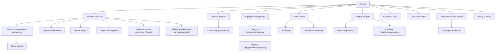

# SITE-PLAN.md — Shena Works website

The complete page-by-page plan for shenaworksltd.com: sitemap, navigation, section blocks, wireframes, exact copy, form fields, conditional rules, SEO metadata and analytics hooks. A developer should be able to build every screen from this file plus `DESIGN.md` without guessing.

| Document | Holds |
|---|---|
| `../AGENTS.md` | Handover brief, reading order, rules, definition of done |
| `DESIGN.md` | Design system: tokens, type, components, states, motion, behavior. **Normative for all visuals.** |
| `SITE-PLAN.md` (this file) | What is on every page, in what order, with what words |
| `CONTENT.md` | CMS seed records (services, projects, equipment, team, locations, credentials, testimonials, insights, legal text), the facts register and the publishing gate status of every claim |
| `BUILD-GUIDE.md` | Stack, repository, CMS schema, forms pipeline, SEO, analytics, security, deployment, phased build plan |

**Contents**
1. Conventions
2. Positioning, voice and the publishing gate
3. Sitemap and URL plan
4. Global chrome: header, mobile drawer, mobile action bar, footer, breadcrumbs
5. Block library
6. Page specifications
7. Forms
8. Conditional rendering rules
9. SEO metadata
10. Analytics map
11. Page acceptance checklist

---

## 1. Conventions

- **Copy in "quotes" or in copy tables is final.** Implement it word for word, including sentence case. Headings are typed in sentence case in the CMS and uppercased by CSS (`DESIGN.md` 2.2); never type capitals.
- **`[CONFIRM: …]`** marks a fact that Shena must supply or approve. The surrounding copy is final; only the bracket is replaced. A published page must never contain the string `[CONFIRM` (enforced in `BUILD-GUIDE.md` 9.4).
- **`{field}`** means the value comes from the CMS record named in the section's *Data* line, for example `{project.title}`.
- **Grid notation** follows `DESIGN.md` 2.3: `col-{start}-{span}` on the 16-column grid from `lg`. Below `lg` every block is one column unless stated; `md` two-up is stated explicitly.
- **Surfaces** use `data-surface` values from `DESIGN.md` 2.1: default (white), `subtle`, `dark`, `deep`, `accent`, `photo`.
- **Type tokens** (`display`, `h1`…`h4`, `lead`, `body`, `body-sm`, `body-xs`, `overline`, `label`, `caption`, `figcaption`) and component names (Button `primary`, Card, Accordion…) refer to `DESIGN.md` 2.2 and section 5.
- **Section rhythm**: every block uses "Standard" vertical padding (64 / 80) unless marked *Spacious* (80 / 120), per `DESIGN.md` 2.3.
- **Wireframes** are ASCII, desktop (`lg`, 1160 wide) first, then mobile (`< md`, 375 wide). Boxes show placement, not exact size; sizes come from the block spec.
- **Phone, WhatsApp, email, addresses** are never hard-coded. They come from the `site-settings` global (`CONTENT.md` 1). Copy below shows the current values for readability.
- British/Kenyan English: organisation, programme, metres, kerb, tarmac, cabro, murram.

---

## 2. Positioning, voice and the publishing gate

**Positioning line (used in meta descriptions, About intro, company profile):**
"Shena Works is a Meru-based roads and building contractor that owns its earthmoving plant and works across Meru, Nairobi and the rest of Kenya." `[CONFIRM: Newton approves positioning]`

**Audiences, priority order:** (1) private developers and hospitality owners; (2) county governments and road agencies; (3) equipment-hire customers; (4) subcontractors, suppliers, job seekers (later phase).

**Voice rules (apply to every string you add, including alt text and error messages):**
1. Say what was built, where, for whom and how big, in plain words and local terms (cabro, murram, grading, culverts, kerbs).
2. Numbers only when Shena can prove them. No "50+ projects", "100+ clients" or "5+ years" until `CONTENT.md` 1 marks them verified.
3. No superlatives: never "premier", "leading", "best", "world-class", "exceptional", "unrivalled", "cutting-edge", "seamless".
4. Each page ends with the next step that fits it; vary the call-to-action wording (quote, estimate, consultation, hire, call, WhatsApp).
5. Name the people behind the work, with their approval.
6. Do not call anyone "Eng." or "engineer" as a professional title unless their Engineers Board of Kenya registration is on file (`CONTENT.md` 7). Job titles held ("Site Engineer at …") may be stated as history.

**Publishing gate (enforced in the CMS, `BUILD-GUIDE.md` 5.3):**

| Content | Publishes only when |
|---|---|
| Credential | Certificate file uploaded and expiry date set |
| Project | Completion evidence or client confirmation recorded; Shena's role and the delivering company stated |
| Testimonial | Written permission file attached, with name, title, organisation and date. Endorsements from serving public officials are never used as lead proof (never on Home, never first in a list). |
| Service | Shena delivers it with any required registrations. *Architecture and consultancy* and *Bills of quantities and estimating* stay unpublished until a registered architect / quantity surveyor (staff or named partner) is on file. |
| Photo | Real Shena project photograph that Shena owns or may license; alt text and caption filled. No stock, no AI-generated images. |
| Stat / proof item | Marked `verified` in `site-settings.proofItems` |

---

## 3. Sitemap and URL plan

### 3.1 Sitemap



### 3.2 URL table

| # | Route | Template (6.x) | `<title>` source | Primary action | Index | At launch |
|---|---|---|---|---|---|---|
| 1 | `/` | Home 6.1 | 9 | Request a quote | yes | yes |
| 2 | `/about` | About: Company 6.2 | 9 | Contact | yes | yes |
| 3 | `/about/leadership` | Leadership 6.3 | 9 | Contact | yes | yes, once bio is confirmed |
| 4 | `/about/credentials-and-safety` | Credentials 6.4 | 9 | Download company profile | yes | yes, if ≥ 1 credential passes the gate; otherwise held back (8) |
| 5 | `/services` | Services index 6.5 | 9 | Choose a service | yes | yes |
| 6 | `/services/road-construction-and-earthworks` | Service 6.6 | record | Request a quote | yes | yes |
| 7 | `/services/road-construction-and-earthworks/cabro-paving` | Service (child) 6.6 | record | Request a quote | yes | yes |
| 8 | `/services/general-construction` | Service 6.6 | record | Request a quote | yes | yes |
| 9 | `/services/interior-design` | Service 6.6 | record | Request a consultation | yes | yes, if confirmed (`CONTENT.md` 3) |
| 10 | `/services/project-management` | Service 6.6 | record | Request a consultation | yes | yes |
| 11 | `/services/architecture-and-consultancy` | Service 6.6 | record | Request a consultation | yes | **gated** |
| 12 | `/services/bills-of-quantities-and-estimating` | Service 6.6 | record | Request an estimate | yes | **gated** |
| 13 | `/projects` | Projects index 6.7 | 9 | Request a quote | yes | yes |
| 14 | `/projects/[slug]` | Case study 6.8 | record | Request a quote | yes | per record |
| 15 | `/equipment` | Equipment index 6.9 | 9 | Request hire | yes | yes |
| 16 | `/equipment/[category]` | Equipment category 6.10 | record | Request hire | yes | categories with ≥ 1 published machine |
| 17 | `/equipment/[category]/[slug]` | Machine 6.11 | record | Request hire | yes | per record |
| 18 | `/insights` | Insights index 6.12 | 9 | Contact | yes | yes, if ≥ 1 post; otherwise held back |
| 19 | `/insights/category/[slug]` | Insights index (filtered) 6.12 | record | Contact | yes | categories with ≥ 1 post |
| 20 | `/insights/[slug]` | Article 6.13 | record | Varies | yes | per record |
| 21 | `/locations/meru` | Location 6.14 | record | Call or WhatsApp | yes | yes |
| 22 | `/locations/nairobi` | Location 6.14 | record | Call or WhatsApp | yes | only if the Nairobi office is staffed `[CONFIRM]` |
| 23 | `/contact` | Contact and quote 6.15 | 9 | Submit enquiry | yes | yes |
| 24 | `/thank-you` | Thank you 6.16 | 9 | Back to site | **noindex** | yes |
| 25 | `/privacy` | Legal 6.17 | 9 | none | yes | yes |
| 26 | `/cookies` | Legal 6.17 | 9 | none | yes | yes |
| 27 | `/downloads/company-profile` | 302 to the PDF in media storage | n/a | n/a | noindex | if file uploaded |
| 28 | `/sitemap.xml`, `/robots.txt` | generated | n/a | n/a | n/a | yes |
| 29 | `/admin` | Payload admin | n/a | n/a | noindex, disallowed | yes |
| — | 404, 500 | Error 6.18 | 9 | Go home | noindex | yes |

**Query parameters used by the site** (all optional, all server-readable so pages work without JavaScript):

| Route | Param | Values | Effect |
|---|---|---|---|
| `/contact` | `type` | `project`, `hire`, `consultation`, `other` | Preselects enquiry type |
| `/contact` | `service` | a service slug | Preselects the service select |
| `/contact` | `equipment` | a machine slug | Preselects type `hire` and the machine |
| `/projects` | `service`, `location`, `year` | slugs / `meru` etc. / `2025` | Filters the grid (F8) |
| `/insights` | `page` | integer | Pagination |
| `/thank-you` | `type` | as above | Picks confirmation copy |

**Not at launch** (spec section 1 and F18–F20): client portal, payments, live booking, Swahili version, careers and supplier registration forms, site search, project map (F17 is a Phase 5 enhancement, 6.7.6).

---

## 4. Global chrome

### 4.1 Header (lg and up)

Component: `DESIGN.md` 5.4 Header, 5.5 Dropdown and mega panel. Height 128 px = secondary row 40 + primary row 88. Transparent over photo heroes (`data-header="transparent"`), white elsewhere. Hide on scroll down, return white on scroll up (`DESIGN.md` 6.3).

```
┌───────────────────────────────────────────────────────────────────────────────────────────┐
│ secondary row 40px, body-xs                 Meru · Nairobi   Call +254 718 971 896   Company profile ↓ │
├───────────────────────────────────────────────────────────────────────────────────────────┤
│ [SHENA WORKS LOGO]      SERVICES ▾  PROJECTS  EQUIPMENT ▾  ABOUT ▾  INSIGHTS  CONTACT   [WA] [REQUEST A QUOTE] │
└───────────────────────────────────────────────────────────────────────────────────────────┘
```

| Element | Spec |
|---|---|
| Logo | Left, in a box 40 px tall (48 px from `xl`), width auto from the logo's aspect ratio, max width 167 px. Links to `/`, `aria-label="Shena Works home"`. White version on transparent header; full-color version on white header. Supply both as SVG (`CONTENT.md` 2, input I-12). |
| Secondary row, right-aligned, 24 px gaps | 1. "Meru · Nairobi" plain text `body-xs` (links to `/locations/meru` and `/locations/nairobi` individually if the Nairobi page is live). 2. "Call +254 718 971 896" → `tel:` link, fires `call_click` (location `header`). 3. "Company profile" + 16 px download icon → `/downloads/company-profile`, fires `file_download`. Hidden if no file. |
| Primary nav (`label`, 32 px gaps) | Services (dropdown), Projects, Equipment (dropdown), About (dropdown), Insights (hidden if Insights is held back), Contact. Items with dropdowns are a link + chevron toggle pair (`DESIGN.md` 6.4) so "Services", "Equipment" and "About" still navigate to their index pages. |
| WhatsApp icon button | Icon button 40 × 40 (dense), WhatsApp glyph 24 px, `aria-label="Chat on WhatsApp"`, opens `https://wa.me/254718971896?text={page message}` (4.6) in a new tab, fires `whatsapp_click` (location `header`). Brand glyphs (WhatsApp, LinkedIn, Facebook) are the single allowed exception to the stroke-only icon rule: monochrome, `currentColor`, filled. |
| Quote button | Button `primary`, label "Request a quote", → `/contact?type=project`. On `/contact` it becomes Button `light` with `aria-current="page"`. |

**Services mega panel** (`DESIGN.md` 5.5; three link columns + one aside):

| Column overline | Links |
|---|---|
| "Roads and earthworks" | Road construction and earthworks · Cabro paving |
| "Buildings and interiors" | General construction · Interior design |
| "Planning and delivery" | Project management · Architecture and consultancy* · Bills of quantities and estimating* |
| Aside (col 13-3), `subtle` surface, padding 24 | Overline "Hire equipment", `h4` "Excavators, graders, rollers and bulldozers", link button "See the fleet" → `/equipment` |

\*Rendered only when the service record is published. Footer link: "All services" (`label` link, arrow-right) → `/services`.

**Equipment dropdown:** one column, links to each published category (Excavators, Motor graders, Rollers and compactors, Bulldozers) then "All equipment" → `/equipment`, then "How hire works" → `/equipment#how-hire-works`.

**About dropdown:** Company → `/about`; Leadership → `/about/leadership`; Credentials and safety → `/about/credentials-and-safety` (if live); Download company profile (if file).

### 4.2 Header and drawer (below lg)

52 px bar: logo left (height 32 px, keep aspect ratio), WhatsApp icon button and menu toggle right (8 px apart). Drawer per `DESIGN.md` 5.6 / 6.5.

```
┌──────────────────────────────┐        ┌──────────────────────────────┐
│ [LOGO]              [WA] [≡] │        │ [LOGO]              [WA] [×] │
└──────────────────────────────┘        ├──────────────────────────────┤
                                        │ SERVICES                   › │  level 0, h4 rows, 1px rules
                                        │ PROJECTS                     │
                                        │ EQUIPMENT                  › │
                                        │ ABOUT                      › │
                                        │ INSIGHTS                     │
                                        │ CONTACT                      │
                                        │                              │
                                        │ [ REQUEST A QUOTE (primary) ]│  full width
                                        │ ── utility area 128px ────── │
                                        │ Call +254 718 971 896        │
                                        │ WhatsApp us                  │
                                        │ shenaworksltd@gmail.com      │
                                        └──────────────────────────────┘
```

Level 1 for Services lists: "All services" first, then the published services; Cabro paving appears indented under Road construction (16 px left padding, `body` style). Level 1 for Equipment and About mirror 4.1.

### 4.3 Mobile action bar (below lg)

A Shena-specific composite built only from `DESIGN.md` tokens. Implements spec section 9 "sticky quote button and WhatsApp icon on mobile" and F3/F4.

```
┌──────────────────────────────────────────────┐
│  [☎] CALL   │  [WA] WHATSAPP  │ REQUEST A QUOTE │   56px + safe-area inset
└──────────────────────────────────────────────┘
```

| Property | Value |
|---|---|
| Position | `position: fixed; bottom: 0; left: 0; right: 0`; z 20 (`--z-sticky`) |
| Size | Height 56 px (`space-14`) + `env(safe-area-inset-bottom)` padding |
| Surface | `white`, 1 px `grey-300` top hairline, elevation 1 |
| Cells | 3 equal columns. Cell 1 and 2: `label` text + 18 px icon (8 px gap), `ink-900`, hover/pressed fills from the `grey-100` ladder (white → `grey-100` → `grey-300` as a `subtle`-style swipe). Cell 3: Button `primary` filling the cell, no outer margin. |
| Actions | Call → `tel:+254718971896` (`call_click`, location `action_bar`). WhatsApp → page message link (`whatsapp_click`, `action_bar`). Quote → `/contact?type=project`, or the page's own preset (service pages: `?type=project&service={slug}`; machine pages: label "Request hire", `?equipment={slug}`; interior/PM pages: label "Book a consultation", `?type=consultation&service={slug}`). |
| Hidden when | at `lg` and up; while the drawer or a dialog is open; while any form field on the page is focused (keyboard open); on `/contact` and `/thank-you` (cell 3 is replaced by "Email us" on `/contact`: show bar with Call, WhatsApp, Email). |
| Page offset | `body { padding-bottom: calc(56px + env(safe-area-inset-bottom)) }` below lg so the footer is never covered. |
| Motion | Enters with the page; hides/shows with `opacity` + `translateY(100%)`, 200 ms `ease-out-cubic`; reduced motion: instant. |
| Landmark | `<nav aria-label="Quick actions">` |

### 4.4 Closing call-to-action band (global block `CtaBand`, used at the end of most pages)

Mirrors the McCarthy "Let's build together" band. Spacious section, white page background.

```
┌───────────────────────────────────────────────────────────┐
│ [ photo, col 1-11, 16:9 / 8:5 from lg, text-on-photo ramp ]    ┌──────────────────┐ │
│                                                                 │ overline TALK TO US│ │
│   LET'S TALK ABOUT                                              │ h4 Call or WhatsApp│ │
│   YOUR SITE                         (display, white)            │ +254 718 971 896   │ │
│   [ REQUEST A QUOTE ] primary                                   │ [CALL] [WHATSAPP]  │ │
│                                                                 └──────────────────┘ │
└───────────────────────────────────────────────────────────┘
```

| Part | Spec | Copy |
|---|---|---|
| Photo | Col 1-11 at lg (bleeds left), `photo` surface with the text-on-photo gradient; below lg full width 4:3 | Default image from `site-settings.ctaImage` (people and machines on a Shena site). Alt: `{image.alt}` |
| Headline | `display`, white, bottom-left, padding 56 px (24 below lg) | Line 1 "Let's talk about", line 2 "your site" (one `<h2>`; the break is a `<br>` only from md) |
| Button | `primary` | "Request a quote" → `/contact?type=project` (pages may override label and link; see each page) |
| Card | White, elevation 1, col 12-4, overlapping the photo's right edge by one column, vertically centered, padding 40; below lg it stacks under the photo at full width with `subtle` surface | overline "Talk to us"; `h4` "Call or WhatsApp"; `body` "{phoneDisplay}"; `body-xs` "{officeHours}" (hidden if not set); buttons: `secondary` "Call" (tel) and `outline` "WhatsApp" (wa.me) side by side, 8 px gap |

### 4.5 Footer

Component `DESIGN.md` 5.24. Surface `dark` (`ink-900`). 16-column grid at lg.

```
┌──────────────────────────────────────────────────────────────────────────────┐
│ [LOGO white]                                   (col 2-4)                       │
│ Connecting communities. Building the future.   body-sm grey-500                │
│                                                                               │
│ SERVICES          COMPANY             EQUIPMENT          CONTACT               │
│ Road construction About Shena Works   Excavators         +254 718 971 896      │
│ Cabro paving      Leadership          Motor graders      WhatsApp us           │
│ General constr.   Credentials & safety Rollers           shenaworksltd@gmail.com│
│ Interior design   Projects            Bulldozers         Meru office: {address}│
│ Project mgmt      Insights            How hire works     Nairobi office: {addr}│
│                   Company profile ↓                      Mon–Sat {hours}       │
│                                                                               │
│ [in] [f]                       NCA {category} · Reg. No. {number}              │
│ ───────────────────────────────────────────────────────────────────────────── │
│ © 2026 Shena Works Limited. All rights reserved.   Privacy · Cookies · Cookie settings · Sitemap │
└──────────────────────────────────────────────────────────────────────────────┘
```

| Area | Grid (lg) | Content |
|---|---|---|
| Brand | col 2-4 | Logo (white, 48 px tall box), motto "Connecting communities. Building the future." (`body-sm`, `grey-500`) |
| Services | col 6-2 | Published services, in this order: Road construction and earthworks, Cabro paving, General construction, Interior design, Project management, Architecture and consultancy*, Bills of quantities and estimating* |
| Company | col 8-2 | About Shena Works, Leadership, Credentials and safety*, Projects, Insights*, Company profile (download)* |
| Equipment | col 10-2 | Published categories + "How hire works" |
| Contact | col 12-4 | Phone (tel, `call_click` location `footer`), "WhatsApp us" (`whatsapp_click` `footer`), email (mailto), each published location: "{town} office: {address}" linking to `/locations/{slug}`, hours line |
| Social | col 2-4, below brand | LinkedIn and Facebook icon links (brand glyphs, 24 px, `aria-label="Shena Works on LinkedIn"` / "…on Facebook"), only if URLs set in `site-settings.social` |
| Credentials line | col 8-8, right-aligned at lg | `caption`, `grey-500`: "NCA {category} · Company Reg. No. {regNumber}". Each part renders only if verified. |
| Legal row | full content width, 1 px `ink-600` top rule, `caption` `grey-500` | "© {current year} Shena Works Limited. All rights reserved." · links: Privacy → `/privacy`, Cookies → `/cookies`, Cookie settings (button, reopens the consent banner), Sitemap → `/sitemap.xml` |

\*Only if the target is published. Link groups' headings use `overline` (`grey-500`). Below lg the four groups become `accordion--mobile-only` (`DESIGN.md` 5.24); Contact is expanded by default.

### 4.6 WhatsApp pre-filled messages (F3)

Built as `https://wa.me/{whatsappNumber}?text={encodeURIComponent(message)}`. `{whatsappNumber}` in international format without `+` (currently `254718971896` `[CONFIRM: this is the WhatsApp number]`).

| Page | Message |
|---|---|
| Default (any page not listed) | "Hello Shena Works, I found you on your website and would like to talk about a project." |
| Service page | "Hello Shena Works, I'm interested in {service.title} in [my location]. Can we talk?" |
| Case study | "Hello Shena Works, I saw the {project.title} project on your website and I'd like something similar." |
| Equipment index / category | "Hello Shena Works, I'd like to hire {category.name or 'equipment'}. Is it available?" |
| Machine page | "Hello Shena Works, I'd like to hire the {machine.name} ({machine.make} {machine.model}). Dates: [ ]. Site location: [ ]." |
| Location page | "Hello Shena Works, I'm in {location.town} and would like to talk about a project." |
| Contact page | "Hello Shena Works, I'd like to request a quote." |

Square-bracket text inside the message is intentional: it prompts the visitor to fill it in.

### 4.7 Breadcrumbs

Component `DESIGN.md` 5.23. Shown on every page except Home, Contact, Thank you and errors. Placed above the `h1` inside the hero (white on `photo` heroes) or at the top of the first section on non-photo pages. Labels:

| Page | Trail |
|---|---|
| Service | Home / Services / {title} |
| Cabro paving | Home / Services / Road construction and earthworks / Cabro paving |
| Case study | Home / Projects / {title} |
| Machine | Home / Equipment / {category.name} / {name} |
| Article | Home / Insights / {category.name} / {title} |
| Leadership | Home / About / Leadership |

Every breadcrumb emits `BreadcrumbList` JSON-LD (`BUILD-GUIDE.md` 8.3).

### 4.8 Cookie consent banner (F13)

Bottom-fixed Message-style panel (`DESIGN.md` 5.11 Information variant, z 60), shown on first visit until a choice is made; sits above the mobile action bar.

| Part | Copy |
|---|---|
| Title (`body` bold) | "Cookies on this site" |
| Body | "We use essential cookies to make this site work. With your permission we'd also like to use analytics cookies (Google Analytics) to understand which pages help visitors. You can change your choice at any time from \"Cookie settings\" in the footer." Link "Read our cookie notice" → `/cookies` |
| Buttons | `secondary` "Accept analytics" · `outline` "Essential only" (equal prominence; no pre-ticked boxes) |
| Result | Writes `sw_consent=analytics|essential` (first-party, 12 months), updates Google Consent Mode, dismisses with a 200 ms fade. |

---

## 5. Block library

Every page is composed from these blocks. Each block is a React server component (client only where marked ⚡) in `src/components/blocks/` (`BUILD-GUIDE.md` 4). Blocks use only `DESIGN.md` tokens. "Hide if" rules are mandatory (section 8).

### 5.1 `HomeHero`

Component `DESIGN.md` 5.19. `photo` surface, min-height 560 / 720 at lg, header transparent above it, hero settle entrance.

```
┌──────────────────────────────────────────────────────────────┐
│ (transparent header over top gradient)                        │
│                                                                │
│                                                                │
│  overline ROADS AND BUILDING CONTRACTORS · MERU AND NAIROBI    │
│  DISPLAY HEADLINE, UP TO 3 LINES                               │ col 2-9
│  lead, max 2 lines                                             │
│  [ REQUEST A QUOTE ]  [ HIRE EQUIPMENT ]                       │
│                                                     caption ↘  │ photo caption bottom-right
└──────────────────────────────────────────────────────────────┘
```

- Content block bottom-aligned, col 2-9 at lg, padding-bottom 80 (64 below lg). Overline → headline 16 px, headline → lead 24 px, lead → buttons 32 px, buttons 8 px apart (stack full width below `sm`).
- Picture: art-directed (`DESIGN.md` 2.6): portrait 4:5-cropped source below lg is not an allowed ratio, so use **1:1 below lg** and **16:9 from lg**, `object-fit: cover`. `fetchpriority="high"`, not lazy. No video on mobile; desktop may use a muted background loop only if a pause control is provided (spec 9: no autoplay above the fold on mobile).
- Photo caption (`caption`, white, bottom-right, 24 px inset): `{image.caption}`, e.g. "Cabro paving at The Pin Hideout". Every image has a caption (spec 9).

### 5.2 `PageHero` (photo) and `PageHeader` (plain)

`PageHero`: same as `HomeHero` but min-height 400 px below lg / 560 px at lg (an allowed reduction since it is not the home hero; uses `space` multiples), headline `h1`, optional `lead`, breadcrumb above the overline, no buttons unless specified. Used on About, Services, Projects, Equipment, service pages, location pages.

`PageHeader`: white surface, padding-top header height + 40 (+ 80 at lg), breadcrumb, overline, `h1`, optional `lead` (col 2-10). Used on Leadership, Credentials, Insights, Contact, Legal, Thank you, errors.

### 5.3 `IntentSelector` (Turner pattern)

Four route tiles directly under the Home hero.

```
┌──────────────┬──────────────┬──────────────┬──────────────┐
│ ━━━━━━━━━━━━ │ ━━━━━━━━━━━━ │ ━━━━━━━━━━━━ │ ━━━━━━━━━━━━ │ 2px grey-300 top rule; accent draws on hover
│ 01           │ 02           │ 03           │ 04           │ overline
│ BUILD A      │ HIRE         │ DESIGN AND   │ WORK WITH US │ h4
│ PROJECT      │ EQUIPMENT    │ INTERIORS    │              │
│ body-sm line │ body-sm line │ body-sm line │ body-sm line │
│            → │            → │            → │            → │ 24px arrow-right
└──────────────┴──────────────┴──────────────┴──────────────┘
```

- Content frame col 2-14; inner grid 4 × 1fr, 32 px gap at lg; 2 × 2 at md; stacked below md (each tile 16 px vertical padding, 1 px `grey-300` divider between).
- Each tile is a stretched-link card (`DESIGN.md` 5.14). The 2 px top rule uses the underline-draw recipe (`DESIGN.md` 10.2 `.u-draw` applied to the top edge): `grey-300` at rest, `accent-500` draws left→right on hover/focus. Ring around the whole tile on focus.
- Section heading (visually hidden `h2`): "What do you need?"

### 5.4 `ProofBar`

Verified facts only. `dark` surface, Standard padding.

```
┌──────────────────────────────────────────────────────────────┐
│  NCA 4            2019            12             2            │ value: h2 style, accent-on-dark
│  Roads & building  In business     Completed      Offices: Meru│ label: body-sm white
│  registration      since           projects       and Nairobi  │
└──────────────────────────────────────────────────────────────┘
```

- Data: `site-settings.proofItems[]` where `verified = true` (value, label). Max 4.
- Layout: lg 4 columns in col 2-14 with 10.769% gap (`DESIGN.md` 2.3 stat rows); md 2 × 2; below md 2 × 2 (values `h3` size).
- Values use `font-header` 400 at `h2` size in `accent-on-dark`; labels `body-sm` white, max 2 lines.
- **Hide if** fewer than 2 verified items. Never show placeholder or unverified numbers.

### 5.5 `SectionIntro`

Heading group used at the top of content sections: optional overline, `h2`, optional `body`/`lead` (col 2-9), optional right-aligned action (`label` link with arrow-right, or Button `secondary`) aligned to the heading baseline at lg (col 12-4, right). Below lg the action moves under the text.

### 5.6 `ServiceGrid`

Cards for published services. White surface.

- lg: 3-up within col 2-14 (32 px gap); md: 2-up; below md: 1-up.
- Card (`DESIGN.md` 5.14): 4:3 image, overline (group: "Roads and earthworks" / "Buildings and interiors" / "Planning and delivery"), `h4` `{service.title}`, `body-sm` `{service.summary}` (max 160 characters), stretched link to the service.
- Order: Road construction and earthworks, General construction, Cabro paving, Interior design, Project management, then gated services if published.

### 5.7 `FeatureSplit` (McCarthy alternating image + panel)

The core storytelling block (McCarthy About / Approach pages).

```
image-left variant:                               image-right variant:
┌───────────────────────────┐                     ┌──────────────┐
│                           │┌──────────────┐     │ panel        │┌───────────────────────────┐
│  image col 1-9 (bleeds)   ││ panel col    │     │ col 2-7      ││ image col 8-9 (bleeds      │
│  4:3                      ││ 9-7, offset  │     │ overlapping  ││ right) 4:3                 │
│                           ││ down 64px,   │     └──────────────┘│                            │
└───────────────────────────┘│ overlaps 1col│                     └───────────────────────────┘
                             └──────────────┘
```

- Image: 4:3 (8:5 allowed), full-bleed to its page edge (col 1-9 or col 8-9), lazy, captioned in `figcaption` below (below lg) or omitted visually but kept as `alt` when a caption would collide; the caption is then shown in the lightbox-free gallery of the target page. *Simplification for this site: always render the caption below the image.*
- Panel: `subtle` (default) or `dark`, padding 56 (24 below lg), vertically centered on the image at lg and overlapping it by one grid column; below lg it stacks under the image with no overlap. Content: optional overline, `h3`, `body` (max 60 words), one Button (`primary` if it is the section's main action, else `secondary`; `outline` on dark → `outline` on dark variant).
- Consecutive FeatureSplits alternate left/right, starting image-left. Reveal on scroll (`DESIGN.md` 6.9).

### 5.8 `StatementBlock`

Large statement with optional body, McCarthy "We've done one thing for over 160 years" pattern: centered, col 4-10, `h2` + `body`, Spacious padding. Used sparingly (once per page maximum).

### 5.9 `ProjectGrid` ⚡ (filters only)

- Cards (`DESIGN.md` 5.14), McCarthy Our Work style: 4:3 image (16:9 for the first card when `featured` layout is on), overline = services joined by ", " in `accent-500` (`overline` style recolored as a signal is allowed because it is a category marker; use `ink-600` if contrast on `subtle` would fail, which it does: on `subtle` surfaces use `ink-600`), `h4` `{project.title}`, `body-xs` `{location} · {year}` uppercase via `overline` style in `ink-600`.
- lg 3-up (col 2-14, 32 px column gap, 56 px row gap), md 2-up, below md 1-up.
- Variants: `home` (max 6 featured projects + filter chips, client-side), `index` (server-side filters and load more, 6.7), `related` (3 items, no filters).
- Filter chips (`home`): Button `subtle` with `aria-pressed`, `label` style, 8 px gap, horizontally scrollable below md with the 48 px edge fade. Chips: "All", "Roads and paving", "Buildings", "Hospitality", "Interiors" (maps to service tags in `CONTENT.md` 4.0). Hide a chip that would return zero cards. Selecting filters the visible cards with the load-more fade (`DESIGN.md` 3.3 G); announce "{n} projects shown" politely.

### 5.10 `EquipmentTeaser`

`dark` surface, Spacious.

- `SectionIntro` on dark: overline "Equipment hire", `h2` "Our machines, with our operators", `body` copy per page, action Button `outline` (on dark) "See the fleet" → `/equipment`.
- Three machine cards (`card--dark`): 4:3 image, overline `{category}`, `h4` `{name}`, `body-xs` `{make} {model} · {capacity}`, stretched link to the machine page.
- Data: up to 3 published machines with `featured = true`, else the first machine of each of the first three categories. **Hide if** 0 machines; show what exists if 1–2.

### 5.11 `WhyShena`

FeatureSplit variant with a list instead of a paragraph. Image left (people + machine on site), `dark` panel right.

- Panel: overline "Why Shena Works", `h3` from page copy, then an ordered list of up to three points; each point is `label`-style title (accent-on-dark number "01"…) + `body-sm` text. Bottom: Button `outline` on dark → `/about/leadership`.
- Each point has a CMS `verified` checkbox in the Home global; unverified points do not render. **Hide if** 0 points.

### 5.12 `TestimonialBlock` ⚡ (only if > 1)

- Single: blockquote (`DESIGN.md` 2.2 blockquote, accent quote glyph), col 4-10 at lg, then `body-sm` bold `{person}`, `body-xs` `{title}, {organisation}` and `caption` `{date formatted "Month YYYY"}`.
- Multiple: Fade carousel (`DESIGN.md` 5.13), arrows + bullets, no autoplay.
- Data: testimonials with `permissionFile` and `published`. Public-official endorsements are excluded from Home by the `isPublicOfficial` flag. **Hide if** 0.

### 5.13 `InsightsRow`

`SectionIntro` (overline "Insights", `h2` "Notes from site", action link "All insights"), then 3 post cards (16:9 image, overline category, `h4` title, `body-xs` date). Scroller carousel below md. **Hide if** fewer than 3 published posts.

### 5.14 `LocationsBand`

`subtle` surface. `SectionIntro` (`h2` "Where to find us"). Two columns (col 2-7 and col 9-7 at lg; stacked below md), one per published location:

- `h3` "{town}"; `body` address lines; `body` phone (tel); `body-xs` hours; `label` links "Get directions" (Google Maps URL, external icon, new tab) and "{town} page" → `/locations/{slug}`.
- No embedded map on Home (keeps the page light and avoids third-party cookies).

### 5.15 `KeyFacts`

McCarthy project header row: a `dl` of 3–6 facts in columns separated by a 2 px `grey-300` top rule each. Term: `overline` `ink-600`; definition: `body` bold `ink-900` (links where relevant, `label` style with underline draw). lg: up to 4 per row inside col 2-14; md 2-up; below md 1-up.

### 5.16 `ScopeList`

Two-column list of what Shena delivers under a service. `h2` (from page), then a `ul` rendered as a 2-column grid at md+ (col 2-14, 32 px gap), each item: `h4` item title + `body-sm` one-sentence description; 2 px `grey-300` top rule per item, 24 px padding top. Below md single column.

### 5.17 `ProcessSteps`

Four steps, uses Timeline `--side-by-side` (`DESIGN.md` 5.15) at lg and single-column timeline below lg. Each entry: overline "Step {n}", `h4` title, `body-sm` text. Scroll-linked fill.

### 5.18 `FaqAccordion`

`DESIGN.md` 5.10, `accordion--single` off (several may be open). `h2` "Questions we're asked" (or page override), col 2-10 at lg. Each item: question as `h4`-style trigger, answer `body` prose. Emits `FAQPage` JSON-LD only for the questions on that page (`BUILD-GUIDE.md` 8.3). 4–6 items.

### 5.19 `Gallery` ⚡

Full-width carousel (`DESIGN.md` 5.13 Full-width variant): 16:9 images (4:3 allowed), each with `figcaption` below. Counter in bullets. Arrows. No autoplay. Keyboard and drag per `DESIGN.md` 6.8/6.12. Minimum 3 images; with 1–2 images render them as stacked figures instead.

### 5.20 `ContactAside`

McCarthy project-page person card. `dark` surface, padding 40, at lg placed col 12-4 sticky (`top: header height + 32`) beside the prose. Content: optional 1:1 portrait (`dur-wipe` is not used here; static), `label` name, `body-xs` role, then icon rows (18 px icons): phone (tel), WhatsApp (wa.me), email (mailto). Data: `site-settings.primaryContact` (a Team record) `[CONFIRM: the person who answers enquiries]`.

### 5.21 `EnquiryForm` ⚡

Full spec in section 7. Block layout: `subtle` surface, Standard padding; `SectionIntro` col 2-9; form col 2-9; aside col 11-5 with "Prefer to talk?" (`h4`), phone, WhatsApp, email, hours and `body-xs` "{responseTimeStatement}" (hidden unless set). Below lg the aside follows the form.

### 5.22 `CredentialTable`

`DESIGN.md` 5.18 Table. Columns: Credential, Issued by, Number, Category, Valid until, Certificate. The last cell is a `label` link "View certificate (PDF)" with download icon, fires `file_download` (`file_name` = credential name). Caption (visually hidden): "Shena Works Limited registrations and certificates". Rows: published credentials sorted by `order`. Expired credentials (valid until < today) are hidden automatically and flagged in the admin dashboard.

### 5.23 `DownloadCard`

`subtle` surface, padding 40, 4 px `accent-500` left bar (prose callout style, `DESIGN.md` 5.17). Overline "Download", `h4` "{title}", `body-xs` "PDF, {size in MB} MB", Button `secondary` "Download" + download icon. Fires `file_download`.

### 5.24 `Prose`

`DESIGN.md` 5.17 / 2.2, col 4-10 at lg (narrow reading), Lexical rich text from the CMS. Allowed nodes: h2, h3, paragraph, bold, italic, link, ul, ol, blockquote, upload (figure with caption), table, horizontal rule, callout block.

### 5.25 `SubNavPanel`

McCarthy About right-hand panel. `dark` surface, padding 40, col 12-4 at lg, aligned to the top of the intro text. `overline` "About" + 1 px `ink-600` rule, then a link list (`label` style, white, underline draw, current page held). Below lg: renders as a horizontal scroller of `subtle` buttons under the page header.

### 5.26 `MapBlock`

Consent embed (`DESIGN.md` 5.16 "Consent embed") wrapping a Google Maps embed for the location's `mapEmbedUrl`. Fallback text: "This map is provided by Google and may set cookies." + link button "Load map" + adjacent text address (always visible). Height: 16:9.

### 5.27 `EmptyState`

`DESIGN.md` 5.20. Copy is given per use.

---
## 6. Page specifications

Each page lists: purpose, route, data, wireframes, then every section in order with its block, layout and **exact copy**. SEO title and description are in section 9; analytics in section 10.

### 6.1 Home `/`

**Purpose:** say what Shena does and where in one screen, then route each audience to its next step. **Primary action:** Request a quote. **Data:** `home-page` global, `site-settings`, services, projects (`featured`), machines (`featured`), testimonials, posts, locations.

#### 6.1.1 Wireframe, desktop

```
┌─────────────────────────────────────────────────────────────────────────────┐
│ HEADER (transparent)                                                         │
│ ┌─────────────────────────────────────────────────────────────────────────┐ │
│ │ 1 HOME HERO  photo: grader / crew on a murram road                       │ │
│ │   ROADS AND BUILDING CONTRACTORS · MERU AND NAIROBI                      │ │
│ │   ROADS, EARTHWORKS AND                                                  │ │
│ │   BUILDINGS, BUILT WITH                                                  │ │
│ │   OUR OWN MACHINES                                                       │ │
│ │   lead…                                                                  │ │
│ │   [REQUEST A QUOTE] [HIRE EQUIPMENT]                                     │ │
│ └─────────────────────────────────────────────────────────────────────────┘ │
│ 2 INTENT SELECTOR  [01 Build a project][02 Hire equipment][03 Design…][04 Work with us] │
│ 3 PROOF BAR (dark)   NCA x | since yyyy | n projects | 2 offices             │
│ 4 SERVICES   h2 + "All services →"                                           │
│   [card][card][card]                                                         │
│   [card][card]                                                               │
│ 5 PROJECTS  h2 + chips [All][Roads and paving][Buildings][Hospitality]       │
│   [card][card][card]                                                         │
│   [card][card][card]          [ ALL PROJECTS ]                               │
│ 6 EQUIPMENT TEASER (dark)  h2 + 3 machine cards + [SEE THE FLEET]            │
│ 7 WHY SHENA  [photo col 1-9] [dark panel: 01 / 02 / 03 + MEET NEWTON]        │
│ 8 TESTIMONIAL  “ quote ”  name, title, organisation                          │
│ 9 INSIGHTS  [card][card][card]                                               │
│ 10 LOCATIONS (subtle)  [Meru] [Nairobi]                                      │
│ 11 CTA BAND  [photo LET'S TALK ABOUT YOUR SITE] [card CALL OR WHATSAPP]      │
│ FOOTER                                                                       │
└─────────────────────────────────────────────────────────────────────────────┘
```

#### 6.1.2 Wireframe, mobile

```
┌───────────────────────────┐
│ [LOGO]          [WA] [≡]  │
│ ┌───────────────────────┐ │
│ │ HERO 1:1 photo        │ │
│ │ overline              │ │
│ │ ROADS, EARTHWORKS AND │ │
│ │ BUILDINGS, BUILT WITH │ │
│ │ OUR OWN MACHINES      │ │
│ │ [REQUEST A QUOTE    ] │ │
│ │ [HIRE EQUIPMENT     ] │ │
│ └───────────────────────┘ │
│ 01 BUILD A PROJECT      → │
│ 02 HIRE EQUIPMENT       → │
│ 03 DESIGN AND INTERIORS → │
│ 04 WORK WITH US         → │
│ PROOF 2×2 (dark)          │
│ SERVICES cards 1-up       │
│ PROJECTS chips ⟷, cards   │
│ EQUIPMENT 1-up cards      │
│ WHY SHENA image + panel   │
│ TESTIMONIAL               │
│ INSIGHTS scroller ⟷       │
│ LOCATIONS stacked         │
│ CTA BAND + card stacked   │
│ FOOTER accordions         │
│ ┌───────────────────────┐ │
│ │CALL│WHATSAPP│QUOTE    │ │ action bar
└───────────────────────────┘
```

#### 6.1.3 Sections and copy

**1 · `HomeHero`**

| Field | Copy |
|---|---|
| Overline | "Roads and building contractors · Meru and Nairobi" |
| Headline (`display`, `<h1>`) | "Roads, earthworks and buildings, built with our own machines" |
| Lead | "We grade, drain and pave roads, and we build homes, lounges and commercial premises across Meru, Nairobi and the rest of Kenya, from site clearing to handover." |
| Button 1 `primary` | "Request a quote" → `/contact?type=project` (`cta_click` hero_quote) |
| Button 2 `outline` on dark | "Hire equipment" → `/equipment` (`cta_click` hero_hire) |
| Image | `home-page.heroImage`. Brief: a Shena grader or roller working a murram or cabro surface with crew visible, landscape, real photo. Caption example: "Grading an access road, Meru County" `[CONFIRM: real caption]` |

**2 · `IntentSelector`** (visually hidden `h2` "What do you need?")

| # | Title (`h4`) | Line (`body-sm`) | Link |
|---|---|---|---|
| 01 | "Build a project" | "Roads, paving, homes and commercial buildings." | `/services` |
| 02 | "Hire equipment" | "Excavators, graders, rollers and bulldozers with operators." | `/equipment` |
| 03 | "Design and interiors" | "Interior fit-outs for homes, lounges and hotels." | `/services/interior-design` (if the gated Architecture page is published, the line becomes "Drawings, interiors and fit-outs." and the link `/services#planning-and-delivery`) |
| 04 | "Work with us" | "Suppliers, subcontractors and people looking for work." | `/contact?type=other` |

**3 · `ProofBar`.** Data from `site-settings.proofItems` (`CONTENT.md` 1.3). Seeded items, all unverified until Shena supplies evidence:

| Value | Label | Evidence required |
|---|---|---|
| "NCA {category}" | "{works type} registration" | NCA certificate |
| "{year}" | "In business since" | Certificate of incorporation |
| "{n}" | "Completed projects" | Project list with completion evidence (count only projects that pass the gate) |
| "2" | "Offices: Meru and Nairobi" | Addresses confirmed and Nairobi staffed |

**4 · Services** (`SectionIntro` + `ServiceGrid`), section `id="services"`

| Field | Copy |
|---|---|
| Overline | "Services" |
| `h2` | "What we build" |
| Body | "One contractor for the road in, the ground it sits on and the building at the end of it." |
| Action | `label` link "All services" → `/services` |

**5 · Projects** (`SectionIntro` + `ProjectGrid` variant `home`)

| Field | Copy |
|---|---|
| Overline | "Projects" |
| `h2` | "Recent work" |
| Body | "Lounges, cottages, villas, paved compounds and roads in Meru County and beyond. Each project page says what we did and who delivered it." |
| Below grid | Button `secondary` "All projects" → `/projects`, centered, 48 px below |
| Hide if | 0 published projects. With 1–2, hide the chips. |

**6 · `EquipmentTeaser`**

| Field | Copy |
|---|---|
| Overline | "Equipment hire" |
| `h2` | "Our machines, with our operators" |
| Body | "Hire an excavator, grader, roller or bulldozer for your site. We quote for the machine, operator and transport, and confirm dates before we move." `[CONFIRM: hire terms include operator and transport]` |
| Action | Button `outline` on dark "See the fleet" → `/equipment` |

**7 · `WhyShena`**

| Field | Copy |
|---|---|
| Overline | "Why Shena Works" |
| `h3` | "We own the plant and we run the site" |
| Point 01 | **"Our own machines"** — "Our excavators, graders and rollers are on your job when the programme says, not when a hire yard can spare them." (verify: fleet list on file) |
| Point 02 | **"Roads and buildings, one contractor"** — "Earthworks, drainage, paving and the building itself are planned and supervised by one team." (verify: confirmed services) |
| Point 03 | **"Led from the site"** — "Our managing director has supervised county road works and inspected urban roads, and still visits every site." `[CONFIRM: wording and that Newton visits every site]` |
| Button | `outline` on dark "Meet our managing director" → `/about/leadership` |
| Image | People and a machine on a Shena site; alt from media. |

**8 · `TestimonialBlock`** (hidden until a testimonial passes the gate; first candidate: Charles Imunde, The Pin Hideout, `CONTENT.md` 8).

**9 · `InsightsRow`** (hidden until 3 posts are published).

**10 · `LocationsBand`**: `h2` "Where to find us"; body none; data from locations.

**11 · `CtaBand`** with defaults (4.4).

**JSON-LD:** `Organization` + `GeneralContractor` (single `@graph`, `BUILD-GUIDE.md` 8.3), `WebSite`.

---

### 6.2 About: Company `/about`

**Purpose:** who Shena is, how it works, where it works. **Primary action:** Contact. **Data:** `about-page` global, team, locations, machines count.

#### 6.2.1 Wireframe, desktop (McCarthy About pattern)

```
┌──────────────────────────────────────────────────────────────────────┐
│ PAGE HERO photo   breadcrumb · overline ABOUT · h1 A MERU CONTRACTOR…  │
├──────────────────────────────────────────────────────────────────────┤
│ INTRO h2 + 3 paragraphs (col 2-9)            ┌ SUB NAV (dark) ───────┐ │
│                                              │ ABOUT ─────────────── │ │
│                                              │ Company (current)     │ │
│                                              │ Leadership            │ │
│                                              │ Credentials and safety│ │
│                                              │ Company profile ↓     │ │
│                                              └───────────────────────┘ │
│ FEATURE SPLIT  [image] [panel ROADS AND EARTHWORKS]                    │
│ FEATURE SPLIT  [panel BUILDINGS AND INTERIORS] [image]                 │
│ FEATURE SPLIT  [image] [dark panel OUR FLEET]                          │
│ PROCESS  HOW WE WORK  step 1 · 2 · 3 · 4 (timeline)                    │
│ STATEMENT  WHAT WE AIM FOR (vision / mission, approved wording)        │
│ FEATURE SPLIT [panel LEADERSHIP] [portrait]                            │
│ LOCATIONS BAND                                                         │
│ CTA BAND                                                               │
└──────────────────────────────────────────────────────────────────────┘
```

Mobile: hero → sub-nav scroller → intro → splits stacked (image then panel) → timeline single column → statement → leadership → locations → CTA.

#### 6.2.2 Sections and copy

| # | Block | Copy |
|---|---|---|
| 1 | `PageHero` | Overline "About" · `h1` "A Meru contractor for roads and buildings" · image: crew on site (alt from media) |
| 2 | Intro (`h2` + body, col 2-9) + `SubNavPanel` | `h2` "Who we are". Body ¶1: "Shena Works Limited is a roads and building contractor based in Meru, with an office in Nairobi. We build access and estate roads, lay cabro paving, cut drains and install culverts, and we put up homes, lounges, cottages and commercial premises." ¶2: "We own and operate our earthmoving plant (excavators, graders, rollers and bulldozers), so the machines a job needs are ours to schedule. We also hire them out, with operators, to other contractors, farmers and developers." ¶3: "We work for private developers, hospitality owners and public bodies, mostly in Meru County and Nairobi, and travel for the right job anywhere in Kenya." `[CONFIRM: client mix and office status]` |
| 3 | `FeatureSplit` image-left, `subtle` panel | Overline "Roads and earthworks" · `h3` "From bush to finished surface" · body "Site clearing, cut and fill, grading and compaction, drainage and culverts, then a murram, gravel, cabro or tarmac surface with kerbs and markings." · Button `secondary` "Road construction and earthworks" → service |
| 4 | `FeatureSplit` image-right, `subtle` panel | Overline "Buildings and interiors" · `h3` "Built to the drawings, finished inside" · body "Foundations, structure, roofing and finishes for homes, lounges, cottages and commercial buildings, with interior fit-outs where the client wants one team to the end." · Button `secondary` "General construction" → service |
| 5 | `FeatureSplit` image-left, `dark` panel | Overline "Our fleet" · `h3` "Machines we own and run" · body "{machineCount} machines across {categoryCount} categories, maintained by us and operated by our own trained operators." (render the numbers from published machines; if 0 machines are published, use: "Excavators, graders, rollers and bulldozers, maintained by us and operated by our own trained operators.") · Button `outline` on dark "See the fleet" → `/equipment` |
| 6 | `ProcessSteps`, `id="how-we-work"` | `h2` "How we work". Steps: **1 "Site visit and brief"** "We visit the site, look at access, soil and drainage, and agree what you need." · **2 "Estimate and programme"** "You get a written quotation with the scope, the programme and what is excluded." · **3 "Build and supervise"** "Our site manager runs the work day to day and reports progress to you." · **4 "Handover"** "We walk the finished work with you, fix any snags and hand over." `[CONFIRM: process matches how Shena works; add defects period if offered]` |
| 7 | `StatementBlock` | `h2` "What we aim for" · body "Roads and buildings that do their job for years, delivered on the scope, price and programme we agreed with you, by a team that leaves the community better connected." `[CONFIRM: Newton approves this replacement for the profile's vision and mission, which use superlatives the voice rules forbid]` · Small `caption` under it: "Our motto: Connecting communities. Building the future." |
| 8 | `FeatureSplit` image-right (portrait 1:1), `subtle` panel | Overline "Leadership" · `h3` "Newton Muthee, Managing Director" · body "Newton leads Shena Works. Before that he managed hospitality builds in Meru County and inspected road works for the Kenya Urban Roads Authority." `[CONFIRM: dates and wording, see CONTENT.md 6]` · Button `secondary` "Read Newton's profile" → `/about/leadership` |
| 9 | `LocationsBand` | `h2` "Our offices" |
| 10 | `CtaBand` | defaults, but button label "Contact us" → `/contact` |

**JSON-LD:** `AboutPage` with `mainEntity` → Organization `@id`; BreadcrumbList.

---

### 6.3 About: Leadership `/about/leadership`

**Purpose:** show the person behind the company with confirmed facts (spec 5.5). **Primary action:** Contact. **Data:** Team record `newton-muthee`, credentials linked to the person.

#### 6.3.1 Wireframe, desktop

```
┌──────────────────────────────────────────────────────────────────────┐
│ PAGE HEADER  breadcrumb · overline ABOUT · h1 LEADERSHIP               │
├──────────────────────────────────────────────────────────────────────┤
│ ┌ portrait 1:1 col 2-5 ┐  overline MANAGING DIRECTOR                  │
│ │                      │  h2 NEWTON MUTHEE                            │
│ │                      │  lead summary (col 7-8)                      │
│ └──────────────────────┘  [CALL] [EMAIL] [LINKEDIN]                   │
│ PROSE  Biography (col 4-10)                                           │
│ TIMELINE  EXPERIENCE                                                  │
│   2024 – present  Managing Director, Shena Works Limited              │
│   2021 – 2022     Roads Inspector, Kenya Urban Roads Authority         │
│   2020 – 2021     Site Project Manager, Dukes Limited                  │
│ KEY FACTS  AREAS OF WORK                                               │
│ CREDENTIAL TABLE (person's own; hidden if none)                        │
│ CTA BAND                                                               │
└──────────────────────────────────────────────────────────────────────┘
```

Mobile: portrait full width 1:1 → name block → buttons stacked → bio → timeline single column → facts → CTA.

#### 6.3.2 Sections and copy

| # | Block | Copy / data |
|---|---|---|
| 1 | `PageHeader` | Overline "About" · `h1` "Leadership" |
| 2 | Person intro: portrait (1:1, col 2-5, `{team.portrait}`), text col 7-8 | Overline "{team.role}" = "Managing Director" · `h2` "{team.name}" = "Newton Muthee" · `lead` "{team.summary}" = "Newton leads Shena Works Limited's road, building and equipment work from Meru, and is on site for the jobs he runs." · Buttons: `secondary` "Call Newton" (tel, only if `team.phone` set) · `outline` "Email" (mailto) · `link` "LinkedIn" (external, if set) |
| 3 | `Prose` `h2` "Biography" | `{team.bio}`, seed text in `CONTENT.md` 6 |
| 4 | Timeline (`DESIGN.md` 5.15 `--centered`), `h2` "Experience" | Entries from `team.experience[]` (`period`, `role`, `organisation`, `summary`), newest first. Seeds in `CONTENT.md` 6, all `[CONFIRM]`. |
| 5 | `KeyFacts`, `h2` "Areas of work" | Terms/definitions: "Roads" — "Grading, drainage, cabro and tarmac works; road inspection" · "Buildings" — "Hospitality and commercial site management" · "Commercial" — "Estimating, bills of quantities review and cost control" · "Compliance" — "Site safety and environmental requirements; data protection training (CIPIT)" `[CONFIRM: each area; CIPIT certificate on file]` |
| 6 | `CredentialTable` filtered to `holder = newton-muthee` | `h2` "Credentials". Hidden if none. |
| 7 | `CtaBand` | defaults |

Rules: no "Eng." prefix and no "Civil Engineer" title unless EBK registration is on file (section 2 rule 6). The KURA Director General endorsement is **not** shown on this page.

**JSON-LD:** `ProfilePage` with `mainEntity` `Person` (name, jobTitle, worksFor → Organization `@id`, image, sameAs LinkedIn), BreadcrumbList.

---

### 6.4 About: Credentials and safety `/about/credentials-and-safety`

**Purpose:** give procurement teams the documents they check first. **Primary action:** Download company profile. **Data:** credentials, `credentials-page` global, `site-settings.companyProfile`.

#### 6.4.1 Wireframe, desktop

```
┌──────────────────────────────────────────────────────────────────────┐
│ PAGE HEADER  breadcrumb · overline ABOUT · h1 CREDENTIALS AND SAFETY   │
│              lead                                                      │
├──────────────────────────────────────────────────────────────────────┤
│ KEY FACTS  Registered name | Reg. No. | Incorporated | KRA PIN | NCA   │
│ CREDENTIAL TABLE                                                       │
│ ┌──────────────┬────────┬────────┬────────┬───────────┬─────────────┐ │
│ │ Credential   │ Issuer │ Number │ Cat.   │ Valid to  │ Certificate │ │
│ └──────────────┴────────┴────────┴────────┴───────────┴─────────────┘ │
│ FEATURE SPLIT [image site safety] [panel SAFETY ON SITE]               │
│ PROSE  Insurance · Environment · Data protection                       │
│ [DOWNLOAD CARD company profile]   [DOWNLOAD CARD safety policy]        │
│ FORM (consultation preset: "Request documents for a tender")           │
└──────────────────────────────────────────────────────────────────────┘
```

#### 6.4.2 Sections and copy

| # | Block | Copy / data |
|---|---|---|
| 1 | `PageHeader` | Overline "About" · `h1` "Credentials and safety" · `lead` "Registrations, certificates and site safety for procurement teams. Every document listed here is on file and can be supplied as a certified copy." |
| 2 | `KeyFacts` (from `site-settings.company`) | "Registered name" — "Shena Works Limited" · "Registration number" — "{regNumber}" · "Incorporated" — "{incorporationDate, Month YYYY}" · "KRA PIN" — shown only if Newton approves publishing it · "Directors" — "{directors}" `[CONFIRM: which directors to list]`. Each fact renders only if set and verified. |
| 3 | `CredentialTable` | `h2` "Registrations and certificates". Seed rows (all unpublished until certificate uploaded): NCA registration (category, works type), NCA contractor practising licence, KRA tax compliance certificate, AGPO certificate (if applicable), Work injury benefits / insurance cover, Business permit (Meru County). See `CONTENT.md` 7. |
| 4 | `FeatureSplit` image-left, `subtle` | Overline "Safety" · `h3` "Safety on site" · body "Every site has a named supervisor, a daily briefing, and protective equipment for everyone on it, including visitors. Machines are operated only by trained operators and checked before each shift." `[CONFIRM: true practice; replace with a summary of the actual safety policy]` · Button (if `safetyPolicy` file) `secondary` "Download our safety policy" |
| 5 | `Prose` (col 4-10) | `h3` "Insurance" — "{insuranceSummary}" `[CONFIRM: insurer, cover types, limits Shena is willing to publish]` · `h3` "Environment" — "We follow the environmental conditions attached to each permit and keep sites, drains and roads clear of spoil and waste." `[CONFIRM]` · `h3` "Data protection" — "We handle personal data under Kenya's Data Protection Act, 2019. See our privacy notice." (link `/privacy`) |
| 6 | Two `DownloadCard`s side by side (col 2-7, col 9-7) | "Company profile" (`site-settings.companyProfile`) · "Safety policy" (`credentials-page.safetyPolicy`). Each hidden if no file. |
| 7 | `EnquiryForm` preset `type=consultation`, service "Tender and procurement documents" | `SectionIntro`: overline "For procurement teams" · `h2` "Request documents for a tender" · body "Tell us the tender number and what you need. We'll send certified copies." |

**Launch rule:** if no credential has passed the gate by launch, this route returns 404, is excluded from the sitemap and nav, and the About sub-nav omits it (section 8).

---
### 6.5 Services index `/services`

**Purpose:** overview of what Shena builds, grouped. **Primary action:** choose a service. **Data:** `services-index` global, published services.

```
┌──────────────────────────────────────────────────────────────────────┐
│ PAGE HERO photo · overline SERVICES · h1 WHAT WE BUILD · lead          │
├──────────────────────────────────────────────────────────────────────┤
│ GROUP 1  id=roads-and-earthworks                                       │
│ h2 ROADS AND EARTHWORKS   body                                        │
│ ┌───────────── image 16:9 col 2-7 ─┐  h3 ROAD CONSTRUCTION…  (col 9-7) │
│ │                                  │  summary · 5 scope bullets        │
│ └──────────────────────────────────┘  [VIEW SERVICE] Cabro paving →    │
│ GROUP 2  id=buildings-and-interiors                                    │
│ [General construction row] [Interior design row]  (same row pattern)   │
│ GROUP 3  id=planning-and-delivery                                      │
│ [Project management row] [Architecture*] [BoQ*]                        │
│ STATEMENT  NOT SURE WHAT YOU NEED?  [TELL US ABOUT THE JOB]            │
│ CTA BAND                                                               │
└──────────────────────────────────────────────────────────────────────┘
```

| # | Block | Copy |
|---|---|---|
| 1 | `PageHero` | Overline "Services" · `h1` "What we build" · `lead` "Roads and earthworks, buildings and interiors, and the planning that keeps them on budget. We list only the work we deliver ourselves." |
| 2 | Group sections (white, alternating `subtle` for group 2) | Group headings (`h2`) and intros: **"Roads and earthworks"** — "Access, estate and feeder roads, paved compounds and the drainage that keeps them standing." · **"Buildings and interiors"** — "Homes, hospitality and commercial buildings, from foundations to fit-out." · **"Planning and delivery"** — "Managing projects for clients, and the estimates and documents that come before a build." |
| 3 | Service rows (one per service in the group) | Image 16:9 (col 2-7) + text (col 9-7): `h3` `{service.title}`, `body` `{service.summary}`, `ul` of first 5 `{service.scope[].title}`, Button `secondary` "View {service.shortTitle}" → service. Rows alternate image side. Road construction row adds a `label` link "Cabro paving" → child page. Below lg: image, then text. |
| 4 | `StatementBlock` | `h2` "Not sure what you need?" · body "Describe the site and what you want at the end. We'll tell you which services apply and what it is likely to involve." · Button `primary` "Tell us about the job" → `/contact?type=project` |
| 5 | `CtaBand` | defaults |

---

### 6.6 Service page template `/services/[slug]` and `/services/road-construction-and-earthworks/cabro-paving`

**Purpose:** convert a visitor with a known need into a quote request (spec 5.2). **Primary action:** per record (`ctaLabel`). **Data:** service record (all copy in `CONTENT.md` 3), related projects, machines, testimonials.

#### 6.6.1 Wireframe, desktop

```
┌──────────────────────────────────────────────────────────────────────┐
│ PAGE HERO photo · breadcrumb · overline {group} · h1 {heroHeadline}    │
│           lead {heroLead} · [REQUEST A QUOTE] [WHATSAPP]               │
├──────────────────────────────────────────────────────────────────────┤
│ KEY FACTS  Where we work | Typical projects | Equipment | Timeframe   │
│ INTRO PROSE (col 4-10) {intro}                                        │
│ SCOPE LIST  h2 WHAT WE DO                                             │
│   ━ item title   ━ item title                                         │
│     one line       one line                                           │
│   ━ …            ━ …                                                  │
│ SUB-SERVICES (only on parent): card → Cabro paving                    │
│ PROCESS  h2 HOW A {SHORT TITLE} JOB RUNS  (4-step timeline)            │
│ RELATED PROJECTS  h2 + 3 cards + "All projects →"                     │
│ EQUIPMENT USED (dark) 3 machine cards                                 │
│ TESTIMONIAL (if linked)                                               │
│ FAQ ACCORDION  h2 QUESTIONS WE'RE ASKED                               │
│ ENQUIRY FORM (subtle) pre-filled service   │ aside: Prefer to talk?    │
└──────────────────────────────────────────────────────────────────────┘
```

Mobile: hero (buttons stacked) → facts 1-up → intro → scope 1-col → process → projects 1-up → equipment 1-up → FAQ → form → action bar.

#### 6.6.2 Sections

| # | Block | Data / copy |
|---|---|---|
| 1 | `PageHero` | Breadcrumb · overline `{service.group}` · `h1` `{service.heroHeadline}` · `lead` `{service.heroLead}` · Buttons: `primary` `{service.ctaLabel}` → `#enquiry` (in-page) · `outline` on dark "WhatsApp us" → service message (4.6) |
| 2 | `KeyFacts` | `{service.keyFacts[]}` (term, value). Always include "Where we work" — "Meru, Nairobi and across Kenya" unless the record overrides. |
| 3 | `Prose` | `{service.intro}` (80–150 words) |
| 4 | `ScopeList` | `h2` "What we do" · `{service.scope[]}` (title + one sentence). Only items Shena delivers. |
| 5 | Sub-services (parent pages only) | `h2` "Specialist work" · cards for child services (Card, 4:3) |
| 6 | Typical project sizes | Inside `KeyFacts` ("Typical projects") — not a separate block |
| 7 | `ProcessSteps` | `h2` "How a {service.shortTitle} job runs" · `{service.process[4]}` |
| 8 | `ProjectGrid` `related` | `SectionIntro`: overline "Projects", `h2` "{service.shortTitle} we've delivered", action "All projects" → `/projects?service={slug}`. Up to 3 projects tagged with this service (manual `relatedProjects` first, then newest by year). Hide if 0. |
| 9 | `EquipmentTeaser` (variant `compact`, no body) | `h2` "Machines on these jobs" · `{service.equipment[]}` (up to 3). Hide if 0. |
| 10 | `TestimonialBlock` | testimonials linked to this service. Hide if 0. |
| 11 | `FaqAccordion` | `{service.faqs[]}` (4–6) |
| 12 | `EnquiryForm` `id="enquiry"` | Preset `type={service.formType}` (`project` or `consultation`) and `service={slug}`. `SectionIntro`: overline "{service.ctaLabel}", `h2` `{service.formHeading}`, body `{service.formIntro}`. |

No `CtaBand` on service pages (the form is the closing action).

**JSON-LD:** `Service` (name, serviceType, provider → Organization `@id`, areaServed: Meru County, Nairobi County, Kenya), `FAQPage`, BreadcrumbList.

---

### 6.7 Projects index `/projects`

**Purpose:** filterable portfolio (F8). **Primary action:** Request a quote. **Data:** `projects-index` global, published projects.

#### 6.7.1 Wireframe, desktop (McCarthy Our Work pattern)

```
┌──────────────────────────────────────────────────────────────────────┐
│ PAGE HERO photo · overline PROJECTS · h1 WORK WE CAN SHOW YOU           │
├──────────────────────────────────────────────────────────────────────┤
│ h2 ALL PROJECTS                                    [FILTERS ⇅] (mobile) │
│ Service [select ▾]  Location [select ▾]  Year [select ▾]  Clear filters│
│ "Showing 9 of 14 projects"                                            │
│ [card][card][card]                                                    │
│ [card][card][card]                                                    │
│ [card][card][card]                                                    │
│                    [ LOAD MORE ]                                       │
│ CTA BAND                                                              │
└──────────────────────────────────────────────────────────────────────┘
```

#### 6.7.2 Behavior and copy

| Part | Spec / copy |
|---|---|
| `PageHero` | Overline "Projects" · `h1` "Work we can show you" · `lead` "Every project here says what we built, where, and what our role was. Where another company delivered the work, we say so." |
| Heading row | `h2` "All projects" |
| Filter bar (lg: inline, col 2-14, 24 px gaps) | Three native Selects (`DESIGN.md` 5.9), labels visible: "Service" (options: "All services" + published services), "Location" (options: "All locations" + distinct `project.location.county` values, e.g. "Meru County", "Nairobi"), "Year" (options: "Any year" + distinct years, newest first). Then `link` button "Clear filters" (shown only when a filter is set). Form is a GET form to `/projects`; without JS it submits with a visible "Apply" Button `secondary`; with JS, changes apply on `change` and update the URL with `history.replaceState`. |
| Filter bar (below lg) | Button `subtle` "Filters" with a count badge text "Filters (2)" opens a Dialog sheet (`DESIGN.md` 5.12) containing the three selects, "Apply" (`primary`) and "Clear" (`link`). |
| Result count | `body-xs` `ink-600`, live region polite: "Showing {shown} of {total} projects" |
| Grid | `ProjectGrid` `index`, 9 per page, newest year first, `featured` projects first within the unfiltered view |
| Load more | Button `secondary` "Load more projects" (`DESIGN.md` 5.22); appends 9; hidden when all are shown. Without JS it is a link to `?page=2` (server renders 18). |
| Empty state | Title "No projects match these filters" · body "Try a different service or location, or clear the filters." · Button `secondary` "Clear filters" → `/projects` |
| Pre-launch empty (0 projects) | Page held back; nav item still shows because the gate requires ≥ 1 project at launch (spec 14). |
| `CtaBand` | defaults |

#### 6.7.6 Project map (F17, Phase 5)

Later: a "Map" toggle (Tabs, `DESIGN.md` 5.8: "Grid" / "Map") showing published projects with `geo` coordinates on a consent-gated map. Not built at launch; the `geo` field exists in the schema now.

**JSON-LD:** `CollectionPage`, BreadcrumbList.

---

### 6.8 Project case study `/projects/[slug]`

**Purpose:** proof for a buyer (spec 5.3). **Primary action:** Request a quote. **Data:** project record (`CONTENT.md` 4).

#### 6.8.1 Wireframe, desktop (McCarthy project pattern)

```
┌──────────────────────────────────────────────────────────────────────┐
│ HERO IMAGE full-bleed 16:9 (no text over it; header white)             │
├──────────────────────────────────────────────────────────────────────┤
│ breadcrumb                                                             │
│ overline PROJECTS                                                      │
│ h1 THE BLACK PERCH LOUNGE                                              │
│ MERU, KENYA  (label, accent-500)                                       │
│ KEY FACTS  Client type | Status | Year | Shena's role | Delivered by   │
│            Services (links)                                            │
├──────────────────────────────────────────────────────────────────────┤
│ (subtle)                                                               │
│ PROSE col 2-9                                  ┌ CONTACT ASIDE dark ┐  │
│ h2 The brief / The work / The result           │ portrait           │  │
│                                                │ NEWTON MUTHEE      │  │
│                                                │ Managing Director  │  │
│                                                │ ☎  WA  ✉           │  │
│                                                └────────────────────┘  │
│ TESTIMONIAL (blockquote, if permitted)                                 │
│ STAT ROW  4,200 m² | 650 m | 7 months   (values accent-500)            │
│ GALLERY full-width carousel with captions                              │
│ CREDITS  Equipment used: Excavator · Grader … | Services: …            │
│ RELATED PROJECTS  [card][card][card]                                   │
│ CTA BAND  "Planning something similar?"                                │
└──────────────────────────────────────────────────────────────────────┘
```

#### 6.8.2 Sections

| # | Block | Data / copy |
|---|---|---|
| 1 | Hero image | `{project.heroImage}` full-bleed, 16:9 (1:1 below md), `fetchpriority="high"`, caption below the title block as `figcaption`. Header theme `white` on this page. |
| 2 | Title block (white, col 2-14) | Breadcrumb · overline "Projects" · `h1` `{project.title}` · location line `label` style in `accent-500`: "{project.location.town}, {project.location.county}" |
| 3 | `KeyFacts` | "Client type" `{clientType}` · "Status" `{status}` ("Completed" / "In progress") · "Year" `{year}` (or "{yearStart}–{yearEnd}") · "Shena's role" `{role}` · "Delivered by" `{deliveringCompany}` · "Services" links to service pages. **"Delivered by" and "Shena's role" are required** (publishing gate). |
| 4 | Body, `subtle` surface: `Prose` col 2-9 + `ContactAside` col 12-4 | Three `h2`s with `{project.brief}`, `{project.work}`, `{project.result}` (150–250 words total). Aside = project contact or `site-settings.primaryContact`. |
| 5 | `TestimonialBlock` single | `{project.testimonial}` if permitted. |
| 6 | Stat row (`ProofBar` layout on white; values `h2` style `accent-500`, labels `body-sm`) | `{project.keyFigures[]}` (value, unit, label), e.g. "{n} m²" / "Cabro paving laid". Value band shown only if `showValueBand`. Hide if 0. |
| 7 | `Gallery` | `{project.gallery[]}` 6–12 images, each captioned (required). Before / during / after order for road jobs. |
| 8 | Credits (`KeyFacts` style, two columns) | "Equipment used" → machine links · "Related services" → service links |
| 9 | `ProjectGrid` `related` | `h2` "More projects", 3 projects sharing a service, excluding this one. Scroller carousel below md. |
| 10 | `CtaBand` | headline "Planning something" / "similar?" · button "Request a quote" → `/contact?type=project&service={primary service}` |

**JSON-LD:** `CreativeWork` is not a good fit for a construction project; use `Article`-less approach: emit only BreadcrumbList plus an `ImageObject` list for the gallery, and reference Organization as `creator` via a lightweight `Project`-less `WebPage` with `about`. Concretely: `WebPage` { `@type`: "WebPage", name, description, primaryImageOfPage, about: Organization `@id` } — see `BUILD-GUIDE.md` 8.3.

---

### 6.9 Equipment index `/equipment`

**Purpose:** catalogue and hire enquiries (spec 5.4, F2). **Primary action:** Request hire. **Data:** `equipment-index` global, categories, machines.

#### 6.9.1 Wireframe, desktop

```
┌──────────────────────────────────────────────────────────────────────┐
│ PAGE HERO photo excavator · overline EQUIPMENT HIRE                    │
│ h1 EXCAVATOR, GRADER, ROLLER AND BULLDOZER HIRE · lead                 │
│ [REQUEST HIRE] [WHATSAPP]                                              │
├──────────────────────────────────────────────────────────────────────┤
│ KEY FACTS  Operator | Fuel | Transport | Service area | Minimum hire   │
│ CATEGORY LINKS  [Excavators] [Motor graders] [Rollers…] [Bulldozers]   │
│ CATEGORY SECTION × n                                                   │
│   h2 EXCAVATORS              "Excavator hire →"                        │
│   [machine card][machine card][machine card]                          │
│ PROCESS id=how-hire-works  h2 HOW HIRE WORKS  4 steps                  │
│ FAQ  h2 HIRE QUESTIONS                                                 │
│ ENQUIRY FORM (hire)                                                    │
└──────────────────────────────────────────────────────────────────────┘
```

#### 6.9.2 Sections and copy

| # | Block | Copy / data |
|---|---|---|
| 1 | `PageHero` | Overline "Equipment hire" · `h1` "Excavator, grader, roller and bulldozer hire" · `lead` "Machines we own and maintain, with our own operators, for contractors, farmers and developers in Meru and across Kenya." · Buttons `primary` "Request hire" → `#enquiry`, `outline` on dark "WhatsApp us" |
| 2 | `KeyFacts` (from `equipment-index.hireTerms`) | "Operator" — "Included with every machine" `[CONFIRM]` · "Fuel" — "{fuel terms}" `[CONFIRM: client or Shena]` · "Transport" — "Low-loader delivery quoted by distance" `[CONFIRM]` · "Service area" — "Meru County and surrounding counties; further by arrangement" `[CONFIRM]` · "Minimum hire" — "{minimum}" `[CONFIRM]` · "Rates" — "Quoted per job" (or indicative rates if Newton decides; open decision 4) |
| 3 | Category links | A row of Button `subtle` links (not tabs) to each category page, scrollable below md. |
| 4 | Category sections (one per published category, alternating white/`subtle`) | `SectionIntro`: `h2` `{category.name}`, `body` `{category.summary}`, action `label` link "{category.name} hire" → `/equipment/{category.slug}`. Grid of machine cards (lg 3-up): 4:3 image, overline `{category.singular}`, `h4` `{machine.name}`, `body-xs` "{make} {model} · {capacity}", `body-xs` availability line with 16 px icon: "Available" (check icon) or "On hire, ask for dates" (info icon), ink-coloured text, never colour-only. |
| 5 | `ProcessSteps` `id="how-hire-works"` | `h2` "How hire works" · **1 "Tell us the job"** "Machine, site location, dates and what the work is." · **2 "Get a quote"** "We confirm availability and send a price for the machine, operator and transport." · **3 "We deliver"** "The machine arrives on a low-loader with its operator, ready to start." · **4 "Work and collect"** "We log hours daily and collect the machine when the job is done." `[CONFIRM: steps and daily hour logs]` |
| 6 | `FaqAccordion` `h2` "Hire questions" | From `equipment-index.faqs` (`CONTENT.md` 5.3) |
| 7 | `EnquiryForm` `id="enquiry"` preset `type=hire` | Overline "Request hire" · `h2` "Check availability" · body "Tell us the machine, dates and site. We'll confirm availability and price." |

---

### 6.10 Equipment category `/equipment/[category]`

Targets searches such as "excavator hire Meru" and "grader hire Kenya" (spec 10).

| # | Block | Copy / data |
|---|---|---|
| 1 | `PageHero` | Breadcrumb · overline "Equipment hire" · `h1` `{category.heroHeadline}` (e.g. "Excavator hire in Meru and across Kenya") · `lead` `{category.heroLead}` · Buttons as 6.9 |
| 2 | `KeyFacts` | Inherits `equipment-index.hireTerms`; category may override |
| 3 | `Prose` | `{category.intro}` (typical uses, what to ask before hiring) |
| 4 | Machine grid | All published machines in the category; cards as 6.9 |
| 5 | Typical uses `ScopeList` | `h2` "What {category.plural} do on site" · `{category.uses[]}` |
| 6 | `ProjectGrid` related | Projects that used machines in this category; hide if 0 |
| 7 | `FaqAccordion` | `{category.faqs[]}` |
| 8 | `EnquiryForm` preset hire + category | `h2` "Hire {category.article} {category.singular}" (e.g. "Hire an excavator") |

**JSON-LD:** `OfferCatalog` under Organization (`hasOfferCatalog`) listing machines as `Offer` with `itemOffered` `Product` (no price unless indicative rates are approved), `FAQPage`, BreadcrumbList.

---

### 6.11 Machine page `/equipment/[category]/[slug]`

```
┌──────────────────────────────────────────────────────────────────────┐
│ breadcrumb                                                             │
│ ┌ GALLERY 4:3 col 2-8 ──────────┐  overline EXCAVATOR                  │
│ │                               │  h1 20-TONNE CRAWLER EXCAVATOR       │
│ │  ‹ 1/5 ›                      │  body-xs Availability: Available     │
│ └───────────────────────────────┘  SPEC TABLE                         │
│                                    Make | Model | Year | Capacity…     │
│                                    [REQUEST HIRE] [WHATSAPP]           │
│ SCOPE LIST  TYPICAL USES                                               │
│ KEY FACTS  HIRE TERMS  Operator | Fuel | Transport | Service area      │
│ ENQUIRY FORM (hire, machine pre-filled)                                │
│ MORE MACHINES  [card][card][card]                                      │
└──────────────────────────────────────────────────────────────────────┘
```

| # | Block | Data / copy |
|---|---|---|
| 1 | Header layout (white, no photo hero; header white) | Left col 2-8: `Gallery` (4:3, thumbnails hidden; arrows + counter). Right col 10-5: breadcrumb, overline `{category.singular}`, `h1` `{machine.name}`, availability line, spec `Table` (rows: Make, Model, Year, Operating weight, Bucket / blade / drum size, Engine power — only rows with values), Buttons `primary` "Request hire" → `#enquiry` and `outline` "WhatsApp us" (machine message). Below lg: gallery, then the right column. |
| 2 | `ScopeList` | `h2` "Typical uses" · `{machine.uses[]}` |
| 3 | `KeyFacts` | `h2` "Hire terms" · `{machine.hireTerms}` falling back to category, then index terms |
| 4 | `EnquiryForm` `id="enquiry"` | preset `type=hire`, `equipment={slug}` · `h2` "Hire the {machine.name}" |
| 5 | Related | `h2` "Other machines" · 3 machine cards (same category first) |

**JSON-LD:** `Product` (name, brand, model, image, category) with `offers` → `Offer` `availability` InStock/OutOfStock, `businessFunction` LeaseOut, `seller` Organization `@id`. No price unless approved. BreadcrumbList.

---
### 6.12 Insights index `/insights` and `/insights/category/[slug]`

| Part | Copy / spec |
|---|---|
| `PageHeader` | Overline "Insights" · `h1` "Notes from site" · `lead` "Practical articles on roads, paving, plant hire and building, written from jobs we've done." |
| Category chips | Links styled as Button `subtle` (current category `aria-current="page"`, pressed fill held): "All" + categories (`CONTENT.md` 10.1: Roads and paving · Equipment · Building · Planning and costs) |
| Grid | Post cards (16:9 image, overline category, `h4` title, `body-sm` excerpt 2 lines, `body-xs` "{date} · {n} min read"). lg 3-up, md 2-up. First post on page 1 of "All" is a wide card spanning col 2-14 with image col 2-9 and text col 11-5. |
| Pagination | Numbered (`DESIGN.md` 5.22), 12 per page, `?page=n`, `rel="prev/next"` not needed; canonical is the page's own URL. |
| Empty category | Not routable (only categories with posts exist). |
| `CtaBand` | defaults |

**JSON-LD:** `Blog` / `CollectionPage`, BreadcrumbList.

### 6.13 Article `/insights/[slug]`

```
┌──────────────────────────────────────────────────────────────────────┐
│ breadcrumb · overline {CATEGORY} · h1 {TITLE} (col 2-12)               │
│ body-xs By {author} · {date} · {n} min read                            │
│ COVER IMAGE 16:9 col 2-14 + figcaption                                 │
│ PROSE col 4-10                                                         │
│ SHARE  WhatsApp · LinkedIn · Copy link   (label links)                 │
│ AUTHOR CARD (subtle) portrait · name · role · "More from {first name}" │
│ RELATED SERVICE BAND (dark FeatureSplit): e.g. Cabro paving → quote    │
│ RELATED POSTS  [card][card][card]                                      │
└──────────────────────────────────────────────────────────────────────┘
```

| Part | Spec |
|---|---|
| Header | Breadcrumb, overline `{category}`, `h1` `{title}`, meta line. Header theme white. |
| Cover | `{coverImage}` 16:9, caption required |
| Body | `Prose` from Lexical; max 75ch |
| Share | `body-xs` label "Share" then `label` links: "WhatsApp" (`https://wa.me/?text={title} {url}`), "LinkedIn" (`https://www.linkedin.com/sharing/share-offsite/?url={url}`), "Copy link" (button; on success, polite status "Link copied") |
| Author card | `subtle`, padding 24, portrait 1:1 80 px (16 × `space-…`: use 80 = `space-20`), name, role |
| Related service | `{post.relatedService}` → FeatureSplit dark: overline "Need this done?", `h3` `{service.title}`, body `{service.summary}`, Button `outline` on dark `{service.ctaLabel}` → `/contact?type={formType}&service={slug}`. Fallback: `CtaBand` defaults. |
| Related posts | 3 posts, same category first; hide if 0 |

**JSON-LD:** `Article` (headline, image, datePublished, dateModified, author → Person, publisher → Organization `@id`), BreadcrumbList.

### 6.14 Location page `/locations/[slug]`

**Purpose:** rank for local searches ("contractors Nairobi", "road construction Meru") and give directions. **Primary action:** Call or WhatsApp. **Data:** location record (`CONTENT.md` 9), services, projects filtered by county, machines.

```
┌──────────────────────────────────────────────────────────────────────┐
│ PAGE HERO photo (local job) · overline LOCATIONS                       │
│ h1 ROAD AND BUILDING CONTRACTORS IN MERU · lead                        │
│ [CALL +254…] [WHATSAPP]                                                │
├──────────────────────────────────────────────────────────────────────┤
│ OFFICE (col 2-6)                    MAP (consent embed, col 8-8)       │
│ h2 OUR MERU OFFICE                                                     │
│ address · phone · email · hours                                        │
│ [GET DIRECTIONS ↗]                                                     │
│ PROSE local intro (col 4-10)                                           │
│ SERVICE GRID "What we do in Meru"                                      │
│ PROJECT GRID "Projects in Meru County" (hide if 0)                     │
│ EQUIPMENT TEASER "Equipment hire in Meru"                              │
│ FAQ (local)                                                            │
│ CTA BAND                                                               │
└──────────────────────────────────────────────────────────────────────┘
```

| # | Block | Data / copy |
|---|---|---|
| 1 | `PageHero` | Overline "Locations" · `h1` `{location.heroHeadline}` · `lead` `{location.heroLead}` · Buttons `primary` "Call {phoneDisplay}" (tel), `outline` on dark "WhatsApp us" (location message) |
| 2 | Office + map | `h2` "Our {town} office" · address (`address` element), phone, email, hours (from record) · `label` link "Get directions" (external) · `MapBlock` |
| 3 | `Prose` | `{location.intro}` |
| 4 | `ServiceGrid` | `h2` "What we do in {town}" (all published services) |
| 5 | `ProjectGrid` related | `h2` "Projects in {county}" · projects where `location.county = {location.county}`, up to 6 · hide if 0 |
| 6 | `EquipmentTeaser` | `h2` "Equipment hire in {town}" |
| 7 | `FaqAccordion` | `{location.faqs[]}` |
| 8 | `CtaBand` | defaults |

**JSON-LD:** `GeneralContractor` for the branch (`@id` `{url}#branch`), `parentOrganization` → Organization `@id`, address, geo, telephone, openingHoursSpecification, areaServed; `FAQPage`; BreadcrumbList.

---

### 6.15 Contact and quote `/contact`

**Purpose:** one place to make any enquiry (spec 5.6, F1, F5). **Primary action:** Submit enquiry.

#### 6.15.1 Wireframe, desktop

```
┌──────────────────────────────────────────────────────────────────────┐
│ PAGE HEADER  overline CONTACT · h1 REQUEST A QUOTE OR GET IN TOUCH      │
│              lead                                                      │
├──────────────────────────────────────────────────────────────────────┤
│ FORM col 2-9 (white)                       │ ASIDE col 11-5 (subtle)   │
│ * required                                 │ h4 PREFER TO TALK?        │
│ What can we help with? (radio cards)       │ [CALL +254 718 971 896]   │
│ ( ) Build or renovate  ( ) Hire equipment  │ [WHATSAPP US]             │
│ ( ) Design or consult  ( ) Something else  │ email                     │
│ Name*            Phone*                    │ hours                     │
│ Email (optional)                           │ ──────────────            │
│ Service ▾        Location*                 │ h4 OFFICES                │
│ Budget band ▾    Timeline ▾                │ Meru · address · map link │
│ Message*                                   │ Nairobi · address · link  │
│ Attach drawings or photos (optional)       │                           │
│ [x] consent line                           │                           │
│ [Turnstile]                                │                           │
│ [ SEND ENQUIRY ]                           │                           │
├──────────────────────────────────────────────────────────────────────┤
│ OFFICES WITH MAPS (MapBlock × n)                                       │
└──────────────────────────────────────────────────────────────────────┘
```

Mobile: header → type radios → fields one per row → submit → "Prefer to talk?" aside → offices. Action bar shows Call, WhatsApp, Email.

#### 6.15.2 Copy

| Part | Copy |
|---|---|
| `PageHeader` | Overline "Contact" · `h1` "Request a quote or get in touch" · `lead` "Tell us about the site and what you need. The more detail you give, the more useful our first reply will be." |
| Form | Section 7 |
| Aside | `h4` "Prefer to talk?" · Button `secondary` "Call {phoneDisplay}" · Button `outline` "WhatsApp us" · `body` email link · `body-xs` "{officeHours}" · `body-xs` "{responseTimeStatement}" (e.g. "We reply to enquiries within one working day." — only if Newton commits, open decision) · rule · `h4` "Offices" · for each location: `label` "{town}", `body-sm` address, `label` link "Get directions" |
| Offices band | `subtle`, `h2` "Find our offices", two columns each with `MapBlock` and the address |

**JSON-LD:** `ContactPage`, Organization `contactPoint` (telephone, contactType "sales", areaServed "KE", availableLanguage ["en","sw"]).

### 6.16 Thank you `/thank-you`

`noindex`. `PageHeader` with copy chosen by `?type`. Below it: three link cards (Projects, Equipment, Insights or Services) and the CtaBand card only (no photo).

| `type` | `h1` | Lead |
|---|---|---|
| `project` | "Thank you, we have your enquiry" | "We'll look at the details and call or email you {responseTime or 'soon'}. If it's urgent, call us on {phoneDisplay}." |
| `hire` | "Thank you, we're checking availability" | "We'll confirm whether the machine is free for your dates and send a price. For urgent hire, call {phoneDisplay}." |
| `consultation` | "Thank you, we'll be in touch to arrange a time" | "We'll contact you to agree a time to talk through the project." |
| `other` | "Thank you for getting in touch" | "We've received your message and will reply by email or phone." |

A reference line: `body-xs` "Your reference: {enquiry.reference}" (e.g. SW-2026-0142), passed by a short-lived signed token, not by query string.

### 6.17 Legal pages `/privacy`, `/cookies`

`PageHeader` (overline "Legal", `h1` "Privacy notice" / "Cookie notice", `body-xs` "Last updated {date}") then `Prose` from the `legal-pages` collection (full draft text in `CONTENT.md` 11). The cookie page ends with Button `secondary` "Change cookie settings" (reopens the banner).

### 6.18 Error pages

| Page | Copy |
|---|---|
| 404 | `PageHeader`: overline "Error 404" · `h1` "We can't find that page" · `lead` "It may have moved when we rebuilt the site. Try one of these instead." · Link list (`label` links): Services, Projects, Equipment hire, Contact · Button `primary` "Go to the home page" |
| 500 | overline "Error" · `h1` "Something went wrong on our side" · `lead` "Please try again in a minute. If you were sending an enquiry, call or WhatsApp us on {phoneDisplay} so it isn't lost." · Buttons "Try again" (`secondary`, reload) and "Call us" (`outline`) |

---

## 7. Forms

One `EnquiryForm` component with presets (F1, F2). Component rules: `DESIGN.md` 5.9 (labels always visible, validation on blur and submit, error summary, 48 px fields, `autocomplete` tokens). Submission pipeline, spam protection and storage: `BUILD-GUIDE.md` 7.

### 7.1 Fields

Starts with `body-xs` "* required".

| # | Name (`name` attr) | Label | Control | Required | Shown for type | Options / rules | `autocomplete` |
|---|---|---|---|---|---|---|---|
| 1 | `type` | "What can we help with?" | Radio group (fieldset/legend), 2 × 2 at md+ | yes | all | `project` "Build or renovate a project" · `hire` "Hire equipment" · `consultation` "Design, estimate or consultation" · `other` "Something else (suppliers, subcontractors, jobs)" | — |
| 2 | `name` | "Your name" | Text | yes | all | 2–80 chars | `name` |
| 3 | `phone` | "Phone number" | Tel | yes | all | Help: "We'll call or WhatsApp you on this number." Accepts `07xx xxx xxx`, `01xx xxx xxx`, `+254 7xx…`, `+254 1xx…`; normalised to E.164 `+2547…`/`+2541…`. Foreign numbers allowed if they start with `+`. | `tel` |
| 4 | `email` | "Email (optional)" | Email | no | all | valid email if present | `email` |
| 5 | `organisation` | "Company or organisation (optional)" | Text | no | all | ≤ 120 | `organization` |
| 6 | `service` | "Service" | Select | yes for `project` and `consultation` | project, consultation | Prompt "Choose a service" + published services + "Not sure yet" | — |
| 7 | `equipment` | "Machine" | Select | yes for `hire` | hire | Prompt "Choose a machine or type" + each category as "Any {singular}" + each published machine as "{name} ({make} {model})" | — |
| 8 | `hireStart` | "Start date" | Date | yes for `hire` | hire | today or later | — |
| 9 | `hireDuration` | "How long do you need it?" | Select | yes for `hire` | hire | "1 day" · "2–6 days" · "1–2 weeks" · "2–4 weeks" · "More than a month" · "Not sure" | — |
| 10 | `location` | "Site location" | Text | yes for project, hire | project, hire, consultation | Help: "Town, area or road, e.g. Makutano, Meru." 2–120 | `address-level2` |
| 11 | `budgetBand` | "Budget" | Select | no | project, consultation | "Under KES 1 million" · "KES 1–5 million" · "KES 5–20 million" · "KES 20–50 million" · "Over KES 50 million" · "Not sure yet" `[CONFIRM: bands with Newton]` | — |
| 12 | `timeline` | "When do you want to start?" | Select | no | project, consultation | "As soon as possible" · "Within 3 months" · "3–6 months" · "Later than 6 months" · "Just pricing for now" | — |
| 13 | `message` | Varies: project "Tell us about the project", hire "Anything we should know about the site or work?", consultation "What do you need help with?", other "Your message" | Textarea | yes for project, other, consultation; no for hire | all | 10–3000 chars; Help (project): "Size, what's there now, and what you want at the end." | — |
| 14 | `files` | "Attach drawings, BoQ or photos (optional)" | File input, multiple | no | project, consultation, other | Help: "Up to 3 files, 10 MB each. PDF, JPG, PNG or WEBP." | — |
| 15 | `consent` | "I agree that Shena Works may use these details to respond to my enquiry, as described in the privacy notice." (link) | Checkbox | yes | all | must be checked | — |
| 16 | `company_website` | (hidden honeypot, `aria-hidden`, `tabindex="-1"`, off-screen) | Text | must be empty | all | — | `off` |
| 17 | `cf-turnstile-response` | Turnstile widget (managed mode), placed above the button | — | yes | all | verified server-side | — |
| — | hidden | `sourcePage`, `utm_source`, `utm_medium`, `utm_campaign`, `utm_term`, `utm_content`, `gclid`, `startedAt` | — | — | all | filled by script | — |

**Layout at lg:** rows — [name 1 | phone 1], [email 1 | organisation 1], [service or equipment 1 | location 1], hire: [hireStart 1 | hireDuration 1], project: [budgetBand 1 | timeline 1], then message, files, consent, Turnstile, submit. Below lg: one per row.

**Type switching:** changing `type` shows/hides fields with `hidden` (no animation beyond the 200 ms field fade) and moves no focus. Values in hidden fields are not submitted. Without JS all fields render, with each field's help text noting the types it applies to, and the server validates per type.

**Presets:** the URL params in 3.2 or the embedding page set `type`, `service`, `equipment`. A preset field remains editable.

### 7.2 Messages

| Situation | Copy |
|---|---|
| Submit button | "Send enquiry" (hire: "Send hire request") · loading state label stays, spinner shown, `aria-busy` |
| Error summary title | "Please fix {n} thing(s) before sending" (singular "thing" when n = 1), each error a link to its field |
| Required missing | "Enter your name" · "Enter a phone number we can reach you on" · "Choose a service" · "Choose a machine" · "Choose a start date" · "Enter the site location" · "Tell us a little about the project" · "Tick the box to agree to how we use your details" |
| Format | "Enter a phone number like 0712 345 678 or +254 712 345 678" · "Enter an email address like name@example.com" · "Choose a start date today or later" |
| Files | "{file} is larger than 10 MB" · "{file} must be a PDF, JPG, PNG or WEBP" · "You can attach up to 3 files" |
| Turnstile failed | "We couldn't confirm you're not a robot. Please try again, or call us on {phoneDisplay}." |
| Rate limited | "You've sent several enquiries in a short time. Please wait a few minutes or call us on {phoneDisplay}." |
| Server error | Error banner: "Your enquiry didn't send because of a problem on our side. Your details are still in the form. Please try again, or call {phoneDisplay}." |
| Success | Redirect to `/thank-you?type={type}` (6.16) |

### 7.3 Staff notification email (F5)

Sent within one minute to `site-settings.enquiryRecipients` (and Telegram if enabled, F15).

```
Subject: [Quote] Road construction, Makutano — Jane Wanjiru (SW-2026-0142)
         [Hire]  Excavator 20 t, from 12 Dec, 1–2 weeks — Peter Mutua (SW-2026-0143)

Body (plain text and simple HTML):
New {type label} enquiry from the website

Name:          {name}
Phone:         {phone}  (tap to call)   WhatsApp: https://wa.me/{phoneDigits}
Email:         {email or "not given"}
Organisation:  {organisation or "—"}
Service:       {service} / Machine: {equipment}
Location:      {location}
Budget:        {budgetBand}   Timeline: {timeline}
Hire:          {hireStart}, {hireDuration}
Message:
{message}

Files: {n} attached — open in admin: {adminUrl}/collections/enquiries/{id}
Source page: {sourcePage}   Campaign: {utm_source}/{utm_medium}/{utm_campaign}
Received: {date time, Africa/Nairobi}
```

### 7.4 Customer acknowledgement email (only if email given)

```
Subject: We've received your enquiry ({reference})

Hello {first name},

Thank you for contacting Shena Works. We've received your {type label} enquiry
and will reply {responseTime or "as soon as we can"}.

Your reference is {reference}. If you need us sooner, call or WhatsApp
{phoneDisplay}.

Shena Works Limited
{Meru office address} · {website}
```

---

## 8. Conditional rendering rules

| Element | Renders when | Otherwise |
|---|---|---|
| Any service, project, machine, credential, testimonial, post, location | `_status = published` **and** its gate fields pass (`BUILD-GUIDE.md` 5.3) | 404, excluded from nav, sitemap, related lists and JSON-LD |
| Credentials page + nav links to it | ≥ 1 published credential | 404; links hidden |
| Insights nav item, Insights index | ≥ 1 published post | 404; nav item hidden |
| `InsightsRow` (Home) | ≥ 3 published posts | hidden |
| Nairobi location page and "Nairobi" mentions in header/footer | Nairobi location published | hidden; header secondary row reads "Meru, Kenya" |
| `ProofBar` | ≥ 2 verified proof items | hidden |
| `WhyShena` point | point marked verified | point hidden; block hidden if 0 |
| `TestimonialBlock` | ≥ 1 testimonial with permission file, matching context | hidden |
| Public-official testimonial | never on Home, never first | — |
| Company profile links | file uploaded | hidden |
| Response-time statement | `site-settings.responseTimeStatement` set | hidden |
| Machine availability line | always (flag true/false) | — |
| Stat row on a case study | ≥ 1 key figure | hidden |
| Gallery | ≥ 3 images (1–2 render as figures) | — |
| Equipment category page | ≥ 1 published machine in it | 404 |
| Related lists | ≥ 1 item | block hidden |
| `[CONFIRM` string in any published field | never | publish blocked by validation (`BUILD-GUIDE.md` 5.3) |

---

## 9. SEO metadata

Titles ≤ 60 characters, descriptions 140–160. Pattern for records: `{title} | Shena Works`. Every page has a canonical URL (absolute, no query string except `/insights?page=n`), Open Graph and Twitter tags, and a 1200 × 630 social image (record image or the generated default, `BUILD-GUIDE.md` 8.4). Editors can override title, description and image per record/global (Payload SEO plugin).

| Page | `<title>` | Meta description |
|---|---|---|
| Home | "Road & Building Contractors in Meru and Nairobi \| Shena Works" | "Shena Works builds roads, cabro paving, drainage and buildings across Meru, Nairobi and Kenya, with its own excavators, graders and rollers. Request a quote." |
| About | "About Shena Works \| Meru Roads and Building Contractor" | "Shena Works Limited is a Meru-based roads and building contractor with its own earthmoving plant, working across Meru, Nairobi and the rest of Kenya." |
| Leadership | "Newton Muthee, Managing Director \| Shena Works" | "Newton Muthee leads Shena Works Limited, with experience in county road works, urban roads inspection and hospitality site management in Meru." |
| Credentials | "Credentials and Safety \| Shena Works Limited" | "Registrations, certificates, insurance and site safety for Shena Works Limited. Procurement teams can request certified copies for tenders." |
| Services | "Construction Services in Meru and Nairobi \| Shena Works" | "Road construction, earthworks, cabro paving, building construction, interior design and project management from one Meru-based contractor." |
| Service pages | from record (`CONTENT.md` 3) | from record |
| Projects | "Projects: Roads, Paving and Buildings \| Shena Works" | "Lounges, cottages, villas, cabro-paved compounds and roads built in Meru County and beyond, with Shena Works' role stated on every project." |
| Case study | "{title}, {town} \| Shena Works Projects" | `{project.metaDescription}` |
| Equipment | "Excavator, Grader and Roller Hire in Meru \| Shena Works" | "Hire excavators, motor graders, rollers and bulldozers with trained operators in Meru and across Kenya. Check availability and get a quote." |
| Category | from record, e.g. "Excavator Hire in Meru and Kenya \| Shena Works" | from record |
| Machine | "{name} for Hire \| Shena Works" | "Hire our {make} {model} {category.singular} with operator in Meru and across Kenya. {capacity}. Check availability and request a quote." |
| Insights | "Insights: Roads, Paving and Plant Hire \| Shena Works" | "Practical articles on road construction, cabro paving, plant hire and building in Kenya, written from Shena Works' own projects." |
| Article | "{title} \| Shena Works" | `{post.excerpt}` |
| Meru | "Road and Building Contractors in Meru \| Shena Works" | from record |
| Nairobi | "Building and Road Contractors in Nairobi \| Shena Works" | from record |
| Contact | "Contact Shena Works \| Request a Quote" | "Request a quote for roads, paving, building or equipment hire. Call or WhatsApp +254 718 971 896, or send us the details online." |
| Privacy | "Privacy Notice \| Shena Works" | "How Shena Works Limited collects, uses and protects personal data under Kenya's Data Protection Act, 2019." |
| Cookies | "Cookie Notice \| Shena Works" | "The cookies shenaworksltd.com uses and how to change your choice." |

Search targets and their landing pages (spec 10) are mapped in `CONTENT.md` 3 and 5 (`primaryKeyword` per record).

---

## 10. Analytics map

GA4 events (spec 10, F12), fired only after analytics consent (`BUILD-GUIDE.md` 8.5). Parameters are snake_case.

| Event | Fired when | Parameters |
|---|---|---|
| `quote_submit` | Server confirms a stored enquiry of type project / consultation / other (fired on `/thank-you` load from a one-time token) | `enquiry_type`, `service`, `source_page` |
| `hire_submit` | Same, type hire | `equipment`, `source_page` |
| `whatsapp_click` | Any wa.me link | `location` (`header`, `action_bar`, `hero`, `cta_band`, `footer`, `contact`, `inline`), `page_type` |
| `call_click` | Any `tel:` link | same as above |
| `email_click` | Any `mailto:` link | `location` |
| `file_download` | Company profile, safety policy, certificate | `file_name` |
| `cta_click` | Primary/secondary hero and CTA band buttons | `cta_id` (e.g. `hero_quote`, `hero_hire`, `ctaband_quote`) |
| `form_start` | First interaction with any enquiry field | `form_preset` |
| `form_error` | Submit attempt with validation errors | `error_count`, `fields` (comma list of names) |
| `filter_use` | Projects filter changed | `filter`, `value` |

Mark `quote_submit`, `hire_submit`, `whatsapp_click`, `call_click` as key events (conversions) in GA4.

---

## 11. Page acceptance checklist

A page is done when every item is true:

1. Every block and string in its section above is present, in order, with the exact copy (placeholders replaced or the page held back).
2. Layout matches the wireframes at 320, 375, 414, 768, 1024, 1160, 1500 and 1920 px; no horizontal scroll except carousels and tables.
3. Only `DESIGN.md` tokens are used; Lighthouse/axe report no contrast failures.
4. Every interactive element has hover, focus-visible, pressed and (where relevant) disabled, loading, invalid states (`DESIGN.md` 4).
5. Works with JavaScript off: content visible, nav links present, forms submit, filters work via GET.
6. Reduced motion honoured.
7. Title, description, canonical, OG image and JSON-LD present and valid (Rich Results Test, Schema validator).
8. Analytics events in section 10 fire (with consent) and do not fire without consent.
9. Conditional rules in section 8 behave: empty data hides the block, unpublished records 404.
10. Mobile Lighthouse ≥ 90 in all four categories on Home, a service, a project and a machine page; page weight under 1.5 MB.
